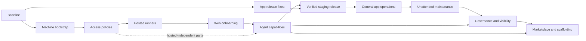

# PSM delivery index — start here

Updated 2026-09-23. This is the single execution order for the PSM plans in this
repository. Detailed specifications remain in their linked documents. Follow
this index to avoid restarting completed work, following obsolete architecture,
or treating every document as a separate project needing another kickoff.

## Current position

| Field | Value |
| --- | --- |
| Next phase | **P05 — Practical agent tools, discovery and task continuity** (P00–P02, P04 verified locally; P03 live hosted acceptance blocked) |
| Execution state | In progress on branch `opus-delivery-20260923-155753` in the isolated delivery workspace `.psm-data/opus-delivery-20260923-155753/workspace/psm`. Nothing pushed or deployed. |
| Latest product decision | Web-based machine onboarding with automatic setup and a copyable one-time administrator fallback; PSM-hosted runners in the first SaaS version. |
| First target | Todo staging on `46.101.29.222` (`werewolf-alpha`); host setup and command-account preflight inspected on 2026-09-23. |
| First complete outcome | From hosted PSM with the laptop disconnected, connect the machine, grant scoped access, deploy Todo staging and verify the result. |
| Resume action | Inspect current changes and verification evidence, map remaining work to P01–P11, then start the first incomplete eligible phase. |

The server-specific script is a tested preflight/reference, not a shipped
onboarding feature. `psm-infra`, `psm-release` and the helper exist on the first
target; the proposed command account has not been created. Its sudo requirement
is a runtime setup dependency to address through the new feature, not a reason
to stop building the feature.

## How to execute continuously

1. Read the current-position table and the first incomplete phase. Read its
   linked specification and applicable repository instructions before editing.
2. Check code and recorded evidence first. Credit already implemented work; do
   not replay an old checklist simply because its boxes were never updated.
3. Complete the phase's remaining work, run the relevant checks and record the
   evidence here or in its linked status record. Track **implemented**, **tested**,
   **committed**, **published** and **deployed** separately.
4. Advance directly to the next eligible phase within the authorized scope.
   Finishing a phase does not require another “shall I continue?” exchange.
5. When a specific action lacks access, a required decision or external service,
   record the exact blocked step and continue independent work. Return to it as
   soon as the prerequisite is satisfied. Never mark blocked work complete.
6. Before a turn/session ends, update the current phase, last verified result,
   pending blocker and exact next action. Resume there rather than replan.

This index organizes work; it does not mint infrastructure permissions or expand
the current read-only Werewolf capability. Reuse existing user authorization and
standing grants. Ask only when genuinely required for the specific next action,
after completing its reviewable preparation and all independent work. Never
request a password in chat. Production deployment, purchases and live data
changes are not implied by aggregating these plans.

Status vocabulary: **next**, **pending**, **in progress**, **blocked**, **verified**.
Only verified acceptance closes a phase. Historical “implemented” or passing
mock tests alone cannot close a live-deployment or hosted-isolation gate.

## Ordered delivery queue

Phase IDs below are the execution order. Numbers inside source documents are
local to those documents; they are not additional competing sequences.

| ID / status | Deliverable | Depends on | Acceptance and source |
| --- | --- | --- | --- |
| **P00 · verified** | Establish the current baseline | — | First triage the uncommitted `dev` working tree (commit, split or discard with the user) so later evidence refers to a known revision. Inventory existing changes in PSM/Todo/Werewolf, identify implemented versus remaining work and reconcile conflicting deployment notes without modifying live state. Confirm which workloads share the first target host. Put every entry in [Open decisions](#open-decisions) in front of the user. Record actual checks and the next concrete code task. [Existing evidence](workspace-implementation-status.md), [ecosystem](ecosystem-integration.md), [first machine](../deploy/machines/todo-staging/README.md). |
| **P01 · verified** | Machine inventory and reusable bootstrap | P00 | Machine/project/environment records, role identities, inspection, generated bootstrap, collision handling and repeatable enrollment work against test hosts. Keep mutations behind existing authority until P02/P03 integrate the new path. [Machine feature](machine-onboarding.md), [account model](agent-access-and-operations.md#first-milestone-prepare-deployment-machines). |
| **P02 · verified** | Unified access policies and credential lifecycle | P01 | Scoped Allow/Ask/Deny rules, presets, durations, delegation, revision checks, revocation and credential leases apply to commands, integrations and deployment. Existing grants migrate without widening. Full access and custom restrictions describe actual enforcement. Starts by making access honest: the current button is renamed to describe its limited managed grants, and blockers report their cause (grant, tool, connection, provider restriction or runner). Full access is unavailable in a Workroom while a provider's bypass disables its sandbox (Codex's boundary is not canary-verified), and scope previews are generated from the argv actually spawned. [Access design](agent-access-and-operations.md#authority-and-execution-design), [existing permission implementation](agent-permissions.md). |
| **P03 · blocked (live)** | Hosted control service and isolated runners | P02 | Workspace-authenticated APIs, reachable enrollment, durable jobs/events, supported provider authentication and secret storage. A job survives a closed browser/worker restart; cross-workspace access is denied. Do not put general multi-customer execution into the existing loopback API or assume the shared staging droplet hosts the runner fleet. [Hosted architecture](agent-access-and-operations.md#runners-and-saas-operation), [web authority](machine-onboarding.md#authorization-through-the-hosted-web-app). |
| **P04 · verified (local)** | Complete machine onboarding in the web app | P01–P03 | Connect → Choose access → Set up → Ready works for new/existing supported hosts. Automatic administrator setup or one generated copyable command, honest progress, retries, verification and connection binding; a second project reuses the machine without inheriting the first one's access. [Complete UX and acceptance](machine-onboarding.md). |
| **P05 · in progress** | Practical agent tools, discovery and task continuity | P02–P04 | Authorized install/build/typecheck/test/preview/browser/command workflows complete from PSM. Discover missing connections and offer Grant and continue; preserve decisions across turns. Compare matched PSM/direct-provider tasks. Parts that do not need hosted runners — native provider session resume instead of history replay, standing-grant MCP calls under P02 policy, and the local-runner execution profile — may start after P02 while P03 is blocked. [Agent diagnosis and runtime](agent-access-and-operations.md), [provider checks](../provider-maintenance.md), [capability baseline](../attach-plan.md). |
| **P06 · pending** | Close existing app/workspace release defects | P00; before P07 | Reverify and finish only outstanding auth, transfer concurrency/retry, viewer UI, membership and browser findings. Test with disposable users across two businesses; preserve personal/offline behavior and correct staging identity. Do not reapply already integrated worktree patches. [Completion plan](workspace-completion-plan.md), [focused regressions](workspace-focused-followup.md), [latest recorded evidence](workspace-implementation-status.md), [current SSO contract](../werewolf-psm-registration.md). |
| **P07 · pending** | First complete hosted-to-staging deployment | P04–P06 | Adopt/verify the selected host roles, resolve enrollment/controller/App/credential prerequisites through the product flows, publish the intended source, build off-host and deploy through the managed engine. Verify DNS/TLS, exact served version, staging login/workspaces and rollback. Laptop disconnected. [First acceptance case](agent-access-and-operations.md#the-enrollment-example-as-the-first-deployment-acceptance-case), [deployment engine](../deploy/DEPLOYMENT-SYSTEM.md), [controller](../deploy/controller/README.md), [staging observations](../deploy/TODO-STAGING.md). |
| **P08 · pending** | General application deployment and operations | P07 | Frontend + API + worker + database recipes, configuration, migrations, diagnostics, restart/scale, backups and recovery work for a representative app. Typed integrations plus custom API/MCP/CLI adapters cover extensibility. [Application operations scope](agent-access-and-operations.md#delivery-sequence), [deployment spec](../deploy/DEPLOYMENT-SYSTEM.md). |
| **P09 · pending** | Unattended maintenance and SaaS operations | P08 | Scheduled/monitor-triggered tasks honor standing grants, recover from interruption, avoid duplicate external mutations, and expose usage/retention limits. Prove restore and credential rotation; optional local/user-hosted runners share the protocol. [Runner requirements](agent-access-and-operations.md#runners-and-saas-operation), [machine lifecycle](machine-onboarding.md#ongoing-machine-management). |
| **P10 · pending** | Complete project governance and agent usage visibility | P05, P09 | Audit the older governance plan against current rules/profile/skills features, then complete only missing applicability/readiness UI, rule provenance and actually observable usage reporting. No duplicate rules system or incompatible metadata migration. [Preserved governance plan](archive/project-governance.plan.json), [archive context](archive/README.md). |
| **P11 · pending** | Capability marketplace and conversational scaffolding | P05, P10 | Resolve registry ownership/review/update policy and the new-project conversation contract; deliver the deferred capabilities after assessing current implementation. Preserve attach/detach ownership and scope-based tool policy. [Attach plan, deferred phases 3–4](../attach-plan.md#11-phases). |

P01 starts machine work first as requested. P03 is an initial-release dependency,
not a later optional hosted phase. P06 can be completed earlier if hosted
provisioning is blocked; it must close before P07. The hosted-independent parts of
P05 (see its row) are the other parallel track while P03 waits on a decision.
P10/P11 do not delay the first useful SaaS deployment.



## Open decisions

These belong to the user and gate the phases shown. Raise them during P00 so a
phase does not discover them halfway through. Record each answer here, dated,
and move it to the resolved list below.

**Answered 2026-09-23 (P00):**

- **Runner hosting:** pluggable, local first. Define the runner backend interface
  and ship a local Docker backend; choose the cloud provider later. P03's live
  hosted acceptance stays **blocked** until then.
- **Model-provider auth:** bring your own key. Each workspace stores its own
  provider API key in the secret broker; PSM carries no model cost.
- **Dapp registration:** deferred. Build workspace authentication against the
  local dapp and pairing; production registration stays **blocked** and
  production is not touched.
- **First target host:** production-adjacent. The runbook records that
  `werewolf-alpha` serves other workloads, and the status record notes that the
  shared droplet's dapp process handles live Stripe. Confirm each mutation there
  individually, even under a standing grant.

The table below keeps the original questions for reference.

| Decision | Gates | Current evidence |
| --- | --- | --- |
| Register PSM with production Werewolf: create the `psm-web` CloudApplication row and choose `PSM_BUSINESS_ID` (the business PSM bills under; needs Stripe Connect onboarding). | P03 workspace-authenticated APIs, P06/P07 hosted sign-in | Production answers `503 app_not_configured`; `PSM_BUSINESS_ID` is "a decision, not a lookup" ([registration](../werewolf-psm-registration.md)). |
| Where the hosted runner fleet runs: provider, isolation technology (containers, microVMs) and monthly budget. | P03 | Only ruled out so far: the shared staging droplet and the loopback agent API. |
| How hosted runners authenticate to model providers unattended (API accounts rather than local CLI logins) and the resulting cost model. | P03, P05 hosted parts | Local CLI logins and OS keyrings are not cloud credentials ([runners](agent-access-and-operations.md#runners-and-saas-operation)). |
| Whether the first target host carries production workloads, and therefore how first mutations there are confirmed. | P01 live tests, P04, P07 | P00 confirms what runs on `werewolf-alpha`. Until then, treat its first mutations as production-adjacent: confirm each specific operation even when a standing grant covers it. |

## Known decisions and conflicts already resolved

- **Hosting:** the current static web page/local-agent implementation is a
  baseline. The user selected PSM-hosted runners for the new SaaS. The old
  `hosted-psm-plan.md` is explicitly superseded and must not block this choice or
  be used as an implementation-ready multi-tenant design.
- **Setup:** manual `scp`/`sudo` instructions and the Todo-specific script are
  references. The product must generate and execute setup or provide the guided
  copyable initial handoff; manual setup is not the P04/P07 acceptance path.
- **Permissions:** keep the current broker, audit, scope and revocation mechanisms,
  but replace fixed per-call review requirements with selected standing policies
  where authorized. Do not continue advertising the present narrow tool list as
  unrestricted full access.
- **Sign-in:** use the current one-web-application PKCE/Origin contract in
  `werewolf-psm-registration.md`; do not rebuild the superseded native-client SSO.
- **Evidence:** old notes disagree about whether host enrollment exists or the
  connection root is stale. Inability to read a root-owned contract does not prove
  absence. Inspect through authorized operations and compare observed revisions.
  The 2026-09-23 account/helper check did not prove target enrollment contents.
- **Workspace work:** older plans say auth is blocked; later status sections
  record local fixes. Reproduce current failures before doing more work. The
  transfer lock-expiry race was still recorded as open; verify current code.
- **Existing architecture:** retain product/service boundaries for this delivery.
  The separate API/DAO extraction proposal below is not a prerequisite.
- **Instructions in older task briefs:** preserve applicable task-specific user
  choices, including the recorded Opus preference for the focused workspace
  follow-up. They do not silently select the engine for every new PSM phase or
  authorize unrelated live changes.

## Complete source index

| Document | Role in this sequence |
| --- | --- |
| [Agent access and operations](agent-access-and-operations.md) | Active overall product/architecture specification; P01–P09. |
| [Machine onboarding](machine-onboarding.md) | Active reusable web feature; P01–P04 and P07. |
| [Agent permissions](agent-permissions.md) | Implemented baseline and runtime limitations to audit/extend in P02/P05. |
| [Ecosystem integration](ecosystem-integration.md) | P00 context and product boundaries; dated readiness observations require recheck. |
| [Workspace completion](workspace-completion-plan.md) | Existing integration acceptance; unfinished portions feed P06/P07. |
| [Focused workspace follow-up](workspace-focused-followup.md) | Specific regression/browser/staging requirements; P06/P07. |
| [Workspace implementation status](workspace-implementation-status.md) | Dated evidence and outstanding findings, not a second execution queue. |
| [Deployment system](../deploy/DEPLOYMENT-SYSTEM.md) | Existing engine/spec, reusable across P01–P09; old runtime-readiness claims need recheck. |
| [Connections](../deploy/CONNECTIONS.md) | Existing connection UX/contracts to integrate with P04. |
| [Todo staging](../deploy/TODO-STAGING.md) | Target history/readiness; P00/P07. |
| [Todo setup helper](../deploy/TODO-STAGING-SETUP.md) | Manual/operator reference; automate its applicable steps in P04/P07. |
| [First machine runbook](../deploy/machines/todo-staging/README.md) | Actual 2026-09-23 preparation evidence and bootstrap reference; not the new product UX. |
| [Prepared Todo target](../deploy/host-targets/werewolf__todo-staging-web.json) | Example pending contract, not live truth or approved configuration; confirm guessed values and observed UIDs. |
| [Release controller](../deploy/controller/README.md) | P07 controller/artifact/key prerequisites and contract. |
| [Publishing a new app](../deploy/PUBLISHING-A-NEW-APP.md) | Historical/manual release reference; managed release is the acceptance path. |
| [Deployment ADR index](../deploy/adrs/README.md) | Existing decisions: monitoring, keyring, Go helper, controller revisions and retention. Revisit explicitly where hosted execution needs a new implementation. |
| [Host helper](../../host-helper/README.md) | Existing privileged executor contract and package/build instructions; P01/P04. |
| [Current PSM registration](../werewolf-psm-registration.md) | Current SSO/registration contract and test evidence; P03/P06. |
| [Old SSO design](../werewolf-sso-plan.md) | Superseded. Historical context only. |
| [Old SSO implementation prompt](../werewolf-sso-dapp-prompt.md) | Historical companion to the old SSO plan; do not execute against the current auth design. |
| [Old hosted design](../hosted-psm-plan.md) | Superseded. Prior constraints/context only; no fresh implementation queue. |
| [Attach/marketplace plan](../attach-plan.md) | Existing attach and plan-UI baseline; deferred marketplace/scaffolding in P11. |
| [Capability catalog](../workspace-capabilities.json) | Current integration declarations; context for P05/P11, never authority to expand a service's access. |
| [Provider maintenance](../provider-maintenance.md) | Current provider discovery/validation contract; P03/P05 and later upgrades. |
| [Preserved governance plan](archive/project-governance.plan.json) | Snapshot of local structured plan revision 3; audit remaining work in P10. |
| [Preserved API/DAO split](archive/api-dao-split.plan.json) | Separate deferred architecture proposal; see below. |

## Separate deferred track: API / DAO extraction

The [July API/DAO split plan](archive/api-dao-split.plan.json) is preserved and
indexed so it is not lost. It is **not queued after P11 automatically**: the more
recent ecosystem direction retains the existing service boundaries for this
rollout. The old plan also contains production cutovers, naming/ownership
decisions and data/billing-related assumptions outside the current PSM delivery.

If the user later activates this track, first revalidate its premises and current
auth/data model. Its internal order is decisions/backups → additive API endpoint
→ repository/pipeline extraction → dashboard cutover → DAO identity/read-only MCP
→ capability registration → documentation. Do not treat its saved `ai-reviewed`
state or unchecked steps as approval to perform those changes.

## Evidence and handoff template

Append one entry per completed increment; update the current-position table too.
Keep the source specifications stable unless a design decision actually changes.

```text
Phase / step:
State: in progress | blocked | verified
Changed files / repositories:
Verification: command or scenario, result, date, evidence path
Delivery state: working tree | committed <id> | published <ref> | deployed <target/version>
Remaining blocker: exact operation, missing input/access, owning service
Independent next work:
Next action: one concrete step, with path/command where useful
```

For source changes, follow the relevant repository's checks and version rules;
PSM generally uses `npm run typecheck` and `npm test`, plus browser checks for
changed UX and host-helper tests for changed Go code. Build/release verification
must use the actual intended artifact. Documentation-only indexing requires link
and content verification, not deployment or a product version bump.

### 2026-09-23 — Index prepared

All plans found in `docs/` and the two local `.psm-plans/` documents are mapped
above. The local structured plans have been preserved as tracked-file candidates
under `archive/`; their saved statuses are historical, not updated implementation
evidence. No roadmap phase is marked implemented by this aggregation.

### 2026-09-23 — P00 baseline

```text
Phase / step: P00
State: verified
Changed files / repositories: psm only. The uncommitted dev tree was committed on
  opus-delivery-20260923-155753 in five themed commits (1fe3d14 agent tools,
  31fc374 deploy diagnosis + Todo host prep, a2b1a05 workspaces + sign-in callback,
  1bd6899 roadmaps, d2ce7e9 release 0.3.3). The main checkout's dev branch is
  untouched; two Codex sessions were active there.
Verification (2026-09-23, at d2ce7e9):
  npm run typecheck                          → exit 0
  npm test                                   → 550 pass, 0 fail (70 test files)
  node --test scripts/setup-todo-staging.test.mjs → 7 pass
  (cd host-helper && go test ./...)          → ok
Delivery state: committed d2ce7e9 (not pushed, not deployed)
Sibling repositories (delivery workspace copies, not modified by P00):
  todo-app      5ff90df, 3 modified files (deployments.json, package.json,
                migrate-todo-workspaces.js)
  werewolf-dapp cdd1cf4 (0.5.4), 2 modified files
Implemented vs remaining, mapped:
  P01  Nothing of the machine model exists. src/server/machine.ts is the local
       process list, unrelated. Reusable inputs: SshHostHelperTransport
       (deploy/adapters/host-helper.ts), SecretBroker (deploy/connections.ts),
       host-helper/packaging/install.sh, and the Todo-specific
       bootstrap-command-user.sh to generalise.
  P02  Per-project boolean grants with revisions and events exist
       (agent-permissions.ts, now 12 keys in 5 categories). No Allow/Ask/Deny,
       durations, presets, delegation or credential leases for commands.
  P03  Absent by design: no psm process on any server today.
  P05  Native provider session resume absent (ai.ts replays 30 events / 48k chars).
  P06  Open: dapp transfer lock-expiry race; todo viewer offered "+ add" inputs
       (finding B); staging still runs dapp 0.5.1 with the three regressions.
       Resolved 2026-09-21: cloud sign-in against a local dapp.
Remaining blocker: none for P01. P03 live acceptance is blocked on the runner
  provider choice; production registration is deferred (see Open decisions).
Independent next work: P06 re-verification can proceed alongside.
Next action: P01 — add src/server/machines/ (records, validated plan, generated
  bootstrap with inspect/apply and collision checks) and prove repeatable
  enrollment against a disposable Ubuntu 20.04 sshd container.
```

### 2026-09-24 — P01 machine inventory and reusable bootstrap

```text
Phase / step: P01
State: verified
Changed files / repositories: psm — src/server/machines/ (plan, roles, store,
  ssh, service, api + tests), db migration 12 (machines, machine_access,
  machine_setup_jobs), server wiring, host-helper/main.go, deploy/connections.ts,
  scripts/machine-test-host/ (Docker image, LXD.md).
Commits: 903d1e7 broker Buffer copies, 9a1a8d9 machines + command access,
  d336c5d real-host tests on LXD, 62fb5dc helper socket directory,
  5ce6921 helper install + deploy identities.
What exists now:
  Machines registered once per workspace; trust only from an operator-confirmed
  fingerprint or an existing pinned connection. Per-project-environment roles:
  command (unprivileged account + workdir), helper (machine-wide install of the
  reproducibly built, digest-checked host helper + nginx/certbot), deploy
  (infrastructure + release accounts, forced-command keys, enrolled target).
  Setup is a durable job: identity → inspect → apply → verify → save. Conflicts
  stop before any change; an interrupted apply is "uncertain" and the retry
  inspects first; success only after logging in as the new identity. Copyable
  one-time command for administrators whose sudo needs a password (command and
  deploy roles). Connections created with the right kinds, scope and, for
  deploy, the target contract fingerprint the helper itself reports.
Verification (2026-09-24):
  npm run typecheck → 0; npm test → 571 pass, 0 fail, 2 real-host skipped
  (cd host-helper && go test ./...) → ok
  PSM_MACHINE_DOCKER=1 real-host.test.ts (unprivileged sshd container) → pass
  PSM_MACHINE_LXD=1 real-host.test.ts (Ubuntu 20.04 LXD container with systemd
    on the homelab, see scripts/machine-test-host/LXD.md) → both tests pass:
    9 command-role scenarios, and helper install + two projects' deploy
    identities with role and project isolation checked through the helper.
  Live server run (throwaway PSM on :4399, in-memory secrets) → discover,
    confirm, inspect, plan, setup, ready over the HTTP API; cross-origin refused.
Bugs found and fixed on the way:
  - SecretBroker copied Buffer secrets with Buffer#slice (a view) then zeroed it,
    wiping stored keys and callers' buffers.
  - Helper runtime directory was root:root 0750, so no deploy account could ever
    reach the socket. The helper already running on werewolf-alpha predates this
    fix: its deploy accounts cannot connect until it is upgraded (P07).
  - /usr/local/libexec is absent on Ubuntu 20.04 minimal; installer creates it.
Delivery state: committed 5ce6921 (not pushed, not deployed)
Not in P01 (tracked): explicit adoption of existing psm-infra/psm-release and
  helper upgrade plans (P07 on werewolf-alpha); enrollment intents, HTTPS
  artifact serving and the web wizard (P03/P04).
Incident: a privileged systemd Docker container froze the desktop twice
  (2026-09-23). Systemd tests now run only in the homelab LXD host.
Next action: P02 — start with honest access (rename the managed "Full access"
  button, report blocker causes), then scoped Allow/Ask/Deny policies.
```

### 2026-09-24 — P02 unified access policies

```text
Phase / step: P02
State: verified (delegation between people carried to P03, which provides hosted auth)
Commits: b643879 rules + presets, 075a08e reviews + MCP rules + server commands,
  cccdc32 access explanation + UI + sandbox-off guard, 09e2ff2 standing deployment
  approval, then the scope chip from resolved directories.
What exists now:
  - Standing grants unchanged (identical authority after migration 13) and read as
    unscoped Allow rules. Scoped Allow/Ask/Deny rules with environment, connection,
    attached tool, task and exact-operation scopes; once/task/until/standing.
    Most specific wins; Deny > Ask > Allow; workspace Deny beats project.
  - Only reductions invalidate running turns (restricted_revision); approvals and
    extra grants let a task continue.
  - Ask → operator review of the exact operation; answers once/task/always/reject.
  - Applies to commands (machine.command via P01 command accounts), integrations
    (mcp.call; no rule keeps per-call review) and deployment (deploy.approve for
    Make-ready plans; acknowledgement-requiring plans only via an exact-environment
    rule; recorded as policy:<rule>@r<revision>).
  - Credential leases: server commands and deployment use the broker's bounded
    leases. Attached MCP servers still take credentials from PSM's environment
    (unchanged; tracked for P05).
  - Honest access: per-task explanation (ready / needs review / grant / connection /
    runner / provider restricted / unsupported) in Capabilities and as the agents'
    access_status tool; versioned presets replace "Grant full access"; workspace
    chat's toggle is "Unrestricted" and confirmed.
  - Workroom rule: sandbox-off is structurally limited to workspace chat and never
    combined with a multi-project scope; the scope chip shows the directories the
    spawn resolves (extraDirsFor), not the saved names.
Verification (2026-09-24): typecheck 0; npm test 591 pass, 0 fail, 2 real-host
  skipped; real-host suite (Docker) passes incl. a live server_command as the
  command account; browser check of Capabilities on a throwaway server (presets,
  rules, access list) — it caught a worktree remote-reading bug, fixed.
Delivery state: committed (not pushed, not deployed)
Next action: P03 — per the 2026-09-23 decisions: a provider-neutral hosted control
  API, durable job queue and runner protocol with a local Docker backend,
  bring-your-own model keys in the secret broker, workspace auth against the local
  dapp. Live hosted acceptance stays blocked until a runner provider is chosen.
```

### 2026-09-24 — P03 hosted control service and runners

```text
Phase / step: P03
State: implemented and verified locally; live hosted acceptance BLOCKED
Commits: a9180e8 control service + runner (+ docs/hosted/README.md)
What exists now: psm-control (separate from the loopback agent) with Werewolf
  identity and membership, per-user personal workspaces, runner registration and
  confinement, durable jobs/events, AES-256-GCM workspace-bound secrets with
  audited per-job leases, bring-your-own model keys verified with the provider,
  single-use enrollment intents; psm-runner with a hardened Docker backend.
Verification (2026-09-24): npm test 603 pass, 0 fail, 3 opt-in skipped;
  PSM_RUNNER_DOCKER=1 real-container suite passes; manual process-level crash
  test (SIGKILL runner + restart control) recovered an idempotent job exactly once.
  Werewolf response shapes checked against werewolf-dapp's psm routes.
Blocked (exact): running psm-control and runners on hosted infrastructure —
  needs the runner provider/budget decision; hosted sign-in needs the production
  psm-web registration (deferred). Not attempted: no infrastructure was created.
Independent next work: P04 wizard against the local control service; P05
  hosted-independent parts.
```

### 2026-09-24 — P04 machine onboarding in the web app

```text
Phase / step: P04
State: verified against the local cockpit and a real systemd server; the hosted
  variant (wizard served by the hosted page, intents claimed over HTTPS, command
  expiry/regeneration) waits on P03's live deployment.
What exists now: Machines panel + Connect → Choose access → Set up → Ready;
  administrator access via an existing key or one reviewed setup command
  (dedicated psm-a-* account, sudoers checked by visudo, removable afterwards),
  detected automatically; deploy access follows the deployment manifest's target;
  setup follows live, continues after reload, retries a step; verified connection
  bound to the deployment's host slot; entry point from Deploy's missing host.
Verification (2026-09-24): npm test 605 pass, 0 fail, 4 opt-in skipped;
  PSM_MACHINE_LXD=1 real-host suite (three tests incl. the handoff) passes;
  browser run end to end against the LXD host: host key compared with the server's
  own fingerprint, one command pasted, PSM detected its admin access, helper +
  deploy + command access verified, Deploy reported "host connected".
Found and fixed in the browser run: generated deploy target could not bind to the
  manifest's; admin command route skipped the review; no-shell check wording.
Noted for P07: todo-app's committed manifest has retainReleases 3 (invalid); its
  working copy has 5 but is uncommitted.
```
