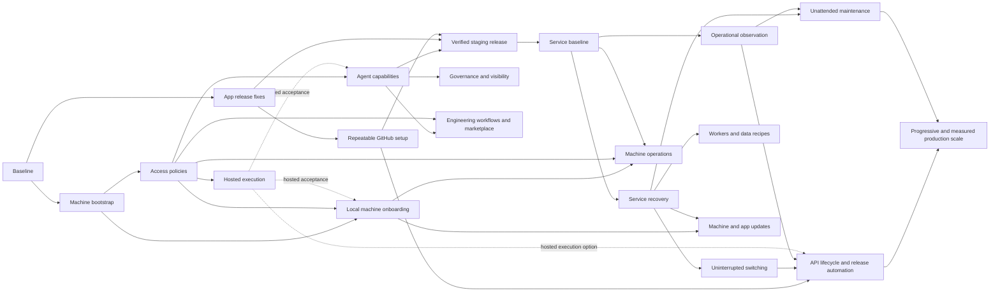

# PSM delivery index — start here

Planning reconciled 2026-10-05; current position rechecked 2026-10-13. This is the single delivery index for the PSM plans
in this repository. Stable phase IDs identify scope; development priority and
prerequisites are listed separately. Detailed specifications remain linked. Follow
this index to avoid restarting completed work, following obsolete architecture,
or treating every document as a separate project needing another kickoff.

## Current position

| Field | Value |
| --- | --- |
| Next phase | **P05 real-project browser acceptance**, alongside P07/P07a remaining release acceptance. The Chromium renderer behind `preview_check` is implemented and its real-container tests pass; what remains is a managed-agent walkthrough of an actual project. P02 local restriction editing and P05 managed Codex continuity are implemented with recorded checks. P03's live hosted gate remains blocked. |
| Execution state | Committed `799c58c` on `dev`, version 0.3.38, clean working tree (2026-10-13). Checks rerun that day: typecheck passed; full suite 837 tests, 831 passed, 0 failed, 6 skipped. Todo staging 0.6.5 is active with 0.6.4, 0.6.1 and 0.6.0 retained; committed Todo source is 0.6.6 and unreleased. Handymanservices now declares **production only**: 1.1.0 is active at `handymanservices.werewolf.solutions`. Details are in the [evidence register](acceptance-evidence.md). |
| Latest product decision | After thorough acceptance, enable automatic staging deployment, then automatic production deployment under explicit environment policies. Each release is gated by tests, compatibility, target health and recovery evidence. P11 adds configurable engineering workflows and harnesses. |
| First target | Todo staging on `46.101.29.222` (`werewolf-alpha`); successful managed release recorded 2026-09-29. |
| First complete outcome | Connect a target, configure authority, deploy and verify staging through PSM; then prove automatic staging and production releases under the accepted policy. Hosted PSM is an execution option with its own P03 acceptance. |
| Resume action | P05 managed-agent browser walkthrough of Todo; P07 Todo rollback rehearsal (four releases are retained, none has been rolled back) and P07a Todo controller migration plus fresh-account flow; then P08a.2 managed recovery, P08a.3 switching and P08d monitoring. P08a.2/P08a.3 need a non-production Node-service target, because the only Node service is now production. Develop P12 contract gates and promotion in parallel. Prove staging automation before production automation. |

### What the current evidence means

- **2026-10-01 Handymanservices checkpoint:** version 1.0.1 from commit
  `ff17b6a` was built by GitHub Actions, installed through the pinned App
  controller and verified in PSM run `run_29d57729336843e6`. The active target
  and public `/`, `/healthz` and `/version.json` probes passed. PSM 0.3.21
  verifies an identical active artifact without uploading it again. Typecheck
  passed; full suite: **740 passed, 5 skipped, 0 failed**. This proves a second
  project's first managed staging deployment, not Node rollback or zero downtime.

- **Earlier 2026-10-01 local checkpoint:** managed commits assigned root release
  versions and synchronized npm lockfiles; readiness rejected old artifacts and
  uncommitted inputs. Preparation refreshed new artifacts in the open page.
  At that checkpoint the suite had **715 passed, 5 skipped, 0 failed** and
  Todo was clean at `ad02646` (0.6.1). Those were historical observations;
  the current Handymanservices result and test count are recorded above.

- **Verified locally:** the machine/access/agent foundations retain their earlier
  evidence; Todo now also has a successful managed release recorded in PSM.
- **Proven on a second live app:** first-time
  [project setup](../deploy/PROJECT-SETUP.md) and the Node-service path completed
  Handymanservices staging. This does not close P08's rollback and zero-downtime work.
- **Still open:** P07 rollback, browser and hosted acceptance; P07a's fresh-account
  button-only GitHub flow; P08 server/worker/database operations. P03 still gates
  the hosted execution case; CI-based automation has its own P12 acceptance.
- **Historical delivery state (October 1):** PSM 0.3.21 source was recorded as
  committed locally on `dev`. The October 5 checkout provenance is in the evidence
  register; no newer test or deployment result is inferred. Todo's earlier
  release evidence remains in [Todo staging](../deploy/TODO-STAGING.md).
- **Latest recorded acceptance checkpoint:** 2026-10-01 typecheck and full PSM suite passed: **740 passed,
  5 skipped, 0 failed**. Authenticated browser behavior and Watch remain untested.

The server-specific script remains a preflight/reference alongside the implemented
machine onboarding UI. The September 23 preflight recorded `psm-infra`,
`psm-release` and the helper on the first target, with the proposed command account
still absent. That historical inventory is not a new account check and is not
the current Todo release blocker.

### Historical 2026-09-29 evidence checkpoint

Read `.psm-data/psm.db` in SQLite read-only mode without starting PSM. The latest
Todo deployment is `run_a7ef155bd9f04884`, `succeeded` / `complete`, finished at
08:54:11 UTC. Its active release receipt names controller run `36545610174`,
Todo commit `9450ccedb9ba08493a6461ab930467ad0ea07625`, version 0.6.0 and four
passed probes. The recorded Todo run history contains no rollback operation;
rollback acceptance remains unproven. Historical handoffs later in this document
that say the release is blocked, unverified or needs the repaired controller
supersede one another chronologically and must not override this checkpoint.

The current tree adds missing-manifest setup, stable-ID assignment, static
repository-file generation and unsupported-stack guidance. Setup detects
handymanservices' Express server and refuses a static-only draft. Reviewed fixes
reject conflicting build files and publish the manifest last; an AI planning
button exposes the remaining recipe work. No handymanservices release was made.

P07a implementation checkpoint: App-token authentication, browser-bound App
registration, installation confirmation, reviewed controller setup/update and
source-token handoff are implemented locally after explicit scope authorization.
The live GitHub App is now installed, ready and bound to Todo staging; its
controller setup and release migration remain pending. See the
[P07a checkpoint](github-button-setup.md#current-implementation-checkpoint).
Todo public probes were rechecked successfully; one retained release means a
rollback rehearsal needs a second verified release first.

## How to execute continuously

1. Read the current-position table and the first incomplete phase. Read its
   linked specification and applicable repository instructions before editing.
2. Check code and recorded evidence first. Credit already implemented work; do
   not replay an old checklist simply because its boxes were never updated.
3. Complete the phase's remaining work, run the relevant checks and record the
   evidence here or in its linked status record. Track **implemented**, **tested**,
   **committed**, **published** and **deployed** separately.
4. Advance directly to the next eligible phase within the authorized scope.
   Finishing a phase does not require another “shall I continue?” exchange.
5. When a specific action lacks access, a required decision or external service,
   record the exact blocked step and continue independent work. Return to it as
   soon as the prerequisite is satisfied. Never mark blocked work complete.
6. Before a turn/session ends, update the current phase, last verified result,
   pending blocker and exact next action. Resume there rather than replan.

This index organizes work; it does not mint infrastructure permissions or expand
the current read-only Werewolf capability. Reuse existing user authorization and
standing grants. Ask only when genuinely required for the specific next action,
after completing its reviewable preparation and all independent work. Never
request a password in chat. Production deployment, purchases and live data
changes are not implied by aggregating these plans.

Status vocabulary: **next**, **pending**, **in progress**, **blocked**, **verified**.
Record implementation, local, target and hosted acceptance separately in the
[evidence register](acceptance-evidence.md). Only a milestone whose required
acceptance passed is verified. A phase with any required gate open stays in
progress; passing mocks cannot close target or hosted acceptance.

## Ordered delivery queue

Phase IDs below are stable scope identifiers. The development sequence below
sets priority, and named prerequisites determine which work is eligible. Local
implementation can proceed while its separate hosted acceptance is blocked.

| ID / status | Deliverable | Depends on | Acceptance and source |
| --- | --- | --- | --- |
| **P00 · verified** | Establish the current baseline | — | First triage the uncommitted `dev` working tree (commit, split or discard with the user) so later evidence refers to a known revision. Inventory existing changes in PSM/Todo/Werewolf, identify implemented versus remaining work and reconcile conflicting deployment notes without modifying live state. Confirm which workloads share the first target host. Put every entry in [Open decisions](#open-decisions) in front of the user. Record actual checks and the next concrete code task. [Existing evidence](workspace-implementation-status.md), [ecosystem](ecosystem-integration.md), [first machine](../deploy/machines/todo-staging/README.md). |
| **P01 · verified** | Machine inventory and reusable bootstrap | P00 | Machine/project/environment records, role identities, inspection, generated bootstrap, collision handling and repeatable enrollment work against test hosts. Keep mutations behind existing authority until P02/P03 integrate the new path. [Machine feature](machine-onboarding.md), [account model](agent-access-and-operations.md#first-milestone-prepare-deployment-machines). |
| **P02 · in progress; local core accepted** | Unified access policies and credential lifecycle | P01; P03 for hosted delegation | Scoped rules, presets, revisions, revocation and leases have recorded local acceptance. Workspace restriction editing is implemented with automated checks in 0.3.26; rendered browser acceptance remains open. Person-to-person delegation and hosted policy management remain open. Scope and actual enforcement must agree. [Editor contract](workspace-policy-editor.md), [permission evidence](agent-permissions.md). |
| **P03 · blocked (live)** | Hosted control service and isolated runners | P02 | Workspace-authenticated APIs, reachable enrollment, durable jobs/events, supported provider authentication and secret storage. A job survives a closed browser/worker restart; cross-workspace access is denied. Do not put general multi-customer execution into the existing loopback API or assume the shared staging droplet hosts the runner fleet. [Hosted architecture](agent-access-and-operations.md#runners-and-saas-operation), [web authority](machine-onboarding.md#authorization-through-the-hosted-web-app). |
| **P04 · in progress; local acceptance recorded** | Complete machine onboarding in the web app | P01 and P02 core; P03 for hosted acceptance | Local wizard and real-host verification are recorded. Remaining hosted HTTPS enrollment, expiry/regeneration and recovery/reuse acceptance are tracked separately. [Complete UX and acceptance](machine-onboarding.md), [evidence register](acceptance-evidence.md). |
| **P05 · in progress; local slices accepted** | Practical agent tools, discovery and task continuity | P02 core; P04 for target commands; P03 for hosted execution | Script execution, discovery, Claude resume and the matched comparison have recorded acceptance. Managed Codex continuity now has protocol/lifecycle and real two-turn 0.160.0 evidence. Rendered Chromium checks through `preview_check` are implemented and gate managed commits; both real-container tests passed 2026-10-13. Remaining: a managed-agent walkthrough of a real project's browser journeys, private dependencies and hosted acceptance. [Website verification](../managed-website-verification.md), [Continuity contract](managed-codex-continuity.md), [evidence register](acceptance-evidence.md), [provider checks](../provider-maintenance.md). |
| **P06 · in progress; code/local browser evidence recorded** | Close existing app/workspace release defects | P00; required staging checks before automatic rollout | Accepted transfer/viewer fixes must be traced into the released candidate, then staged browser/workspace/isolation checks completed. Preserve prior fixes instead of replaying old briefs. [Completion plan](workspace-completion-plan.md), [evidence register](acceptance-evidence.md), [SSO contract](../werewolf-psm-registration.md). |
| **P07 · in progress; static target release accepted** | Complete staging release path | P04 local; relevant P05/P06 slices; P03 for hosted slice | Todo run `run_a7ef155bd9f04884` passed four release probes. Remaining local gate: browser/workspace journey, retained rollback, required Watch and P07a repeatable setup. Hosted execution is a separate acceptance slice. [First case](agent-access-and-operations.md#the-enrollment-example-as-the-first-deployment-acceptance-case), [Todo evidence](../deploy/TODO-STAGING.md). |
| **P07a · in progress** | Button-only GitHub setup | P07 first release | Connect GitHub through the App Manifest flow (Create → Install on GitHub), then only PSM buttons: PSM authenticates as its App, creates and pins the release controller from its reviewed bundle, updates and re-pins it, creates the Environment, and gives each release a one-hour `actions: read` source token instead of a stored artifact-reader App key. Acceptance: a fresh organisation deploys Todo staging with no hand-copied key, variable, push or hash. P07 closes only after this, since its acceptance requires the product flows. [Plan](github-button-setup.md). |
| **P08 · in progress; P08a.1 accepted** | Application deployment and operations | Named milestone prerequisites | Handymanservices moved from staging to production on 2026-10-12/13; on 2026-10-13 the operator chose to rehearse recovery and switching on that production target. P08a.3 switching is implemented and tested against real nginx, not yet on a host. P08a.1 service baseline, P08a.2 recovery, P08a.3 uninterrupted switching, P08b workers/jobs, P08c data/migrations/recovery, P08d observation, **P08e machine inventory and approved app/worker controls**. Later work depends on the relevant accepted milestone. [Milestone scope](application-operations.md), [machine operations plan](../deploy/MACHINE-OPERATIONS.md), [Node recipe](../deploy/NODE-SERVICE-RECIPE.md). |
| **P09 · pending** | Unattended maintenance and SaaS operations | P02 policy; P08a.2/P08d for service maintenance; P03 for hosted jobs | Scheduled/monitor-triggered tasks honor standing grants, recover without duplicate mutations, and expose usage/retention limits. Data-changing tasks need the target's proven recovery path. P08b product schedules and P09 control tasks have separate acceptance. [Operations milestones](application-operations.md), [runner requirements](agent-access-and-operations.md#runners-and-saas-operation). |
| **P10 · pending** | Complete project governance and agent usage visibility | P05 observable tools/context; P03 for hosted reporting | Audit the archived governance plan and finish missing applicability/readiness UI, rule provenance and measurable usage reporting. Local governance does not wait for all P09 maintenance features. [Preserved governance plan](archive/project-governance.plan.json), [archive context](archive/README.md). |
| **M1 · pending** | Keep machines and apps current | P04 local inventory; P08a.2 for app migration | Inventory OS support dates, kernel/reboot, runtimes and host tools; report project runtime constraints, outdated/vulnerable dependencies and a pinned end-of-life data source. Produce tested dependency/runtime commits, reviewed host-tool updates and snapshot/restore-backed OS migration plans. First case: the recorded Ubuntu 20.04/system Node v14 host; consider a fresh supported host plus app migration. Acceptance: one machine and one project updated through PSM with recovery evidence. Schedule this before container recipes needing a newer platform. [Operations boundaries](application-operations.md). |
| **P11 · pending** | Engineering workflows, marketplace and scaffolding | P02 core and relevant P05 tools; P03 for hosted execution | P11a local bundles/components; P11b evaluation and Sandcastle adapter; P11c reviewed marketplace; P11d conversational scaffolding. P10 metadata is reused as available; its full completion is not a prerequisite for local imports. [Workflow milestones](engineering-workflows.md), [attach plan](../attach-plan.md#11-phases). |
| **P12 · pending** | API lifecycle and automatic staging/production releases | Named recipe recovery/health gates; P03 only for hosted control | P12a contract/consumer gates; P12b tested promotion and policy; P12c automatic staging; P12d automatic production after staging acceptance. CI-based execution can proceed independently of hosted fleet provisioning. [Detailed milestones](release-and-api-lifecycle.md#p12--release-promotion-and-api-consumer-lifecycle). |
| **P13 · pending** | Progressive and distributed production operations | P12d, P09 durable operations, target recovery | Progressive rollout, multiple regions/clusters, health gates and failure drills; separate mechanism, scale and control-plane resilience acceptance. [Detailed plan](release-and-api-lifecycle.md#p13--progressive-and-distributed-production-operations). |
| **P14 · in progress; Phase A (A1–A5) verified locally 2026-10-15** | Ecosystem intake, project AI manager and bounded agent jobs | Phase A none (it is P05's remaining blocker); hub/executor slice of P03; jobs are P09's first slice | A: real werewolf-dapp (+ throwaway Mongo/Redis) in the preview sandbox on an internal network. B: PSM hub inside werewolf-dapp + always-on executor. C: `@project` in Todo. D: one-shot read-only triage verdicts. E: queue-driven, budget-capped jobs that idle when empty, with no-progress stop rules and repo write leases. Decisions D1–D5 answered 2026-10-15 (VPS 46.101.14.20 executor; platform vs business apps; local branches only; feedback-hub deferred). [Plan](ecosystem-intake-and-agent-jobs.md). |

### Development sequence and prerequisites

Use this priority order for the release path. Start eligible independent work
when another milestone is blocked; keep each acceptance gate visible.

| Priority | Work | Gate before advancing |
| --- | --- | --- |
| 1 | Close relevant P02/P05 tooling and P06 candidate/browser gaps; finish P07a repeatable controller setup and P07 staging acceptance. | Trace fixes into the released source; prove sign-in/isolation, a second retained static release and rollback. |
| 2 | Complete P08a.2 recovery, P08a.3 service switching and P08d operational health for the first service target. Start P08e read-only machine inventory and bounded controls for a PSM-managed unit; start P12a API contract/consumer checks alongside this. | Evidence for rollback, failed candidate handling, uninterrupted service switch and external monitoring; machine controls need their own installed grant and action verification. |
| 3 | Deliver P12b policy/promotion, then P12c automatic staging and P12d automatic production. | Thorough testing and recipe-specific recovery; staging automation accepted before production automation. Persistent-data targets require their own restore/migration evidence. |
| 4 | Expand accepted production recipes through P08b/P08c and P09 maintenance. | Representative worker/data recovery and durable maintenance acceptance; unrelated recipes do not block the first accepted service. |
| 5 | Deliver P13 progressive/distributed rollout and measured scale/resilience milestones. | P12d and the target's accepted durable operation/recovery path. |

Parallel tracks: P03 hosted infrastructure integrates hosted slices of P04/P05/P07
and P12, and supplies P02 delegation. P03 is required for the first hosted SaaS
outcome; an accepted GitHub/CI executor can deliver automatic releases while the
hosted fleet decision is pending. M1 inventory starts after P04 local inventory;
host/app upgrades use P08a.2 recovery and are scheduled before any recipe that
needs the newer platform. P10 local governance and P11a/P11b workflow management
start after relevant P05 tools; P11c registry and P11d scaffolding have separate
decisions and acceptance. They do not delay the release automation path.



## Open decisions

These belong to the user and gate the phases shown. Raise them during P00 so a
phase does not discover them halfway through. Record each answer here, dated,
and move it to the resolved list below.

**Answered 2026-09-23 (P00):**

- **Runner hosting:** pluggable, local first. Define the runner backend interface
  and ship a local Docker backend; choose the cloud provider later. P03's live
  hosted acceptance stays **blocked** until then.
- **Model-provider auth:** bring your own key. Each workspace stores its own
  provider API key in the secret broker; PSM carries no model cost.
- **Dapp registration:** deferred. Build workspace authentication against the
  local dapp and pairing; production registration stays **blocked** and
  production is not touched.
- **First target host:** production-adjacent. The runbook records that
  `werewolf-alpha` serves other workloads, and the status record notes that the
  shared droplet's dapp process handles live Stripe. Confirm each mutation there
  individually, even under a standing grant.

The table below lists genuinely open implementation inputs. Earlier answers
remain above as dated decisions, rather than being reopened by stale questions.

| Decision | Gates | Current evidence |
| --- | --- | --- |
| Register or repair the single `psm` CloudApplication in production; choose its publisher `PSM_BUSINESS_ID` if the row must be created. | P03 hosted identity and relevant production sign-in | Prior observations found `app_not_configured`; recheck before mutation. Identity setup has no Stripe prerequisite. Billing provisioning is a separate operation. [Registration contract](../werewolf-psm-registration.md). |
| Where the hosted runner fleet runs: provider, isolation technology (containers, microVMs) and monthly budget. | P03 | Only ruled out so far: the shared staging droplet and the loopback agent API. |
| Which provider-specific unattended authentication paths and compute budgets are supported first. | P03/P05 hosted acceptance | Bring-your-own model keys is already decided; supported provider paths need their own evidence. |
| API support window, retirement criteria and owner for migration notices. | P12a/P12d breaking-change policy | Compatible updates need no forced client upgrade; breaking changes require declared support/migration policy before automatic rollout. |
| Registry operator/review keys and the initial conversational scaffolding contract. | P11c/P11d | P11a/P11b local import/evaluation can proceed independently. |
| First distributed provider/workload and measurable scale/recovery targets. | P13 adapter and scale acceptance | Google-scale complexity is the long-term ambition; a Google Cloud adapter is a separate explicitly selected implementation target. |

## Known decisions and conflicts already resolved

- **Release automation (2026-10-05):** prove the workflow thoroughly, then enable
  automatic staging and subsequently automatic production under explicit
  environment policies. Human review is configurable; a local cockpit click is
  not the target requirement for every release. Existing runtime guards remain
  in place until the new executor/policy path passes acceptance.
- **print-shop (2026-10-05):** intentionally stopped to free droplet capacity.
  It is not an unresolved recovery incident or a release-path prerequisite.

- **Hosting:** the current static web page/local-agent implementation is a
  baseline. The user selected PSM-hosted runners for the new SaaS. The old
  `hosted-psm-plan.md` is explicitly superseded and must not block this choice or
  be used as an implementation-ready multi-tenant design.
- **Setup:** manual `scp`/`sudo` instructions and the Todo-specific script are
  references. The product must generate and execute setup or provide the guided
  copyable initial handoff; manual setup is not the P04/P07 acceptance path.
- **Permissions:** keep the current broker, audit, scope and revocation mechanisms,
  but replace fixed per-call review requirements with selected standing policies
  where authorized. Do not continue advertising the present narrow tool list as
  unrestricted full access.
- **Sign-in:** use the current one-web-application PKCE/Origin contract in
  `werewolf-psm-registration.md`: key `psm`, type `web`. Historical `psm-web`
  registration references are superseded; identity and billing are separate.
- **Evidence:** old notes disagree about whether host enrollment exists or the
  connection root is stale. Inability to read a root-owned contract does not prove
  absence. Inspect through authorized operations and compare observed revisions.
  The 2026-09-23 account/helper check did not prove target enrollment contents.
- **Workspace work:** the September 24 P06 handoff records the transfer
  lock-expiry fix and local browser evidence. Trace those fixes into each release
  candidate and reverify staging; do not treat the older finding as unfixed code.
- **Existing architecture:** retain product/service boundaries for this delivery.
  The separate API/DAO extraction proposal below is not a prerequisite.
- **Instructions in older task briefs:** preserve applicable task-specific user
  choices, including the recorded Opus preference for the focused workspace
  follow-up. They do not silently select the engine for every new PSM phase or
  authorize unrelated live changes.

## Complete source index

| Document | Role in this sequence |
| --- | --- |
| [Acceptance and evidence register](acceptance-evidence.md) | Consolidated dated results, open gates and current source provenance; update when each acceptance slice changes. |
| [Application operations milestones](application-operations.md) | P08 service, worker, data and observation scope; named prerequisites for later phases. |
| [Workspace restriction editor](workspace-policy-editor.md) | P02 local UI, management authority, revision fencing and acceptance boundaries. |
| [Managed Codex continuity](managed-codex-continuity.md) | P05 retained managed threads, active-turn tool routing, failure/replay boundaries and native acceptance. |
| [Agent access and operations](agent-access-and-operations.md) | Active overall product/architecture specification; P01–P09. |
| [Machine onboarding](machine-onboarding.md) | Active reusable web feature; P01–P04 and P07. |
| [Agent permissions](agent-permissions.md) | Implemented baseline and runtime limitations to audit/extend in P02/P05. |
| [Ecosystem integration](ecosystem-integration.md) | P00 context and product boundaries; dated readiness observations require recheck. |
| [Workspace completion](workspace-completion-plan.md) | Existing integration acceptance; unfinished portions feed P06/P07. |
| [Focused workspace follow-up](workspace-focused-followup.md) | Specific regression/browser/staging requirements; P06/P07. |
| [Workspace implementation status](workspace-implementation-status.md) | Dated evidence and outstanding findings, not a second execution queue. |
| [Deployment system](../deploy/DEPLOYMENT-SYSTEM.md) | Existing engine/spec, reusable across P01–P09; old runtime-readiness claims need recheck. |
| [Connections](../deploy/CONNECTIONS.md) | Existing connection UX/contracts to integrate with P04. |
| [Todo staging](../deploy/TODO-STAGING.md) | Target history/readiness; P00/P07. |
| [Todo setup helper](../deploy/TODO-STAGING-SETUP.md) | Manual/operator reference; automate its applicable steps in P04/P07. |
| [First machine runbook](../deploy/machines/todo-staging/README.md) | Actual 2026-09-23 preparation evidence and bootstrap reference; not the new product UX. |
| [Prepared Todo target](../deploy/host-targets/werewolf__todo-staging-web.json) | Example pending contract, not live truth or approved configuration; confirm guessed values and observed UIDs. |
| [Release controller](../deploy/controller/README.md) | P07 controller/artifact/key prerequisites and contract. |
| [Button-only GitHub setup](github-button-setup.md) | P07a plan: GitHub App via manifest, PSM-managed controller and pins, per-release source token. |
| [Release and API lifecycle](release-and-api-lifecycle.md) | P12–P13 plan: staging/production promotion, consumer compatibility, change requests and progressive multi-region production. |
| [Project deployment setup](../deploy/PROJECT-SETUP.md) | Implemented static/Node onboarding, current limits and recorded Handymanservices acceptance. |
| [Publishing a new app](../deploy/PUBLISHING-A-NEW-APP.md) | Historical/manual release reference; managed release is the acceptance path. |
| [Deployment ADR index](../deploy/adrs/README.md) | Existing decisions: monitoring, keyring, Go helper, controller revisions and retention. Revisit explicitly where hosted execution needs a new implementation. |
| [Host helper](../../host-helper/README.md) | Existing privileged executor contract and package/build instructions; P01/P04. |
| [Current PSM registration](../werewolf-psm-registration.md) | Current SSO/registration contract and test evidence; P03/P06. |
| [Old SSO design](../werewolf-sso-plan.md) | Superseded. Historical context only. |
| [Old SSO implementation prompt](../werewolf-sso-dapp-prompt.md) | Historical companion to the old SSO plan; do not execute against the current auth design. |
| [Old hosted design](../hosted-psm-plan.md) | Superseded. Prior constraints/context only; no fresh implementation queue. |
| [Attach/marketplace plan](../attach-plan.md) | Existing attach and plan-UI baseline; deferred marketplace/scaffolding in P11. |
| [Engineering workflows](engineering-workflows.md) | P11 extension: evaluate engineering practices, manage bundles and individual components, and integrate Sandcastle through an execution adapter. |
| [Capability catalog](../workspace-capabilities.json) | Current integration declarations; context for P05/P11, never authority to expand a service's access. |
| [ai-mesh provider and execution](ai-mesh-provider.md) | Planned P05/P11 extension: trusted remote routines, bounded open-model implementation, and authorized machine-local subscription providers; P02 permissions, P12 release evidence and P03 only for hosted execution. |
| [Provider maintenance](../provider-maintenance.md) | Current provider discovery/validation contract; P03/P05 and later upgrades. |
| [Preserved governance plan](archive/project-governance.plan.json) | Snapshot of local structured plan revision 3; audit remaining work in P10. |
| [Preserved API/DAO split](archive/api-dao-split.plan.json) | Separate deferred architecture proposal; see below. |

## Separate deferred track: API / DAO extraction

The [July API/DAO split plan](archive/api-dao-split.plan.json) is preserved and
indexed so it is not lost. It is **not queued after P11 automatically**: the more
recent ecosystem direction retains the existing service boundaries for this
rollout. The old plan also contains production cutovers, naming/ownership
decisions and data/billing-related assumptions outside the current PSM delivery.

If the user later activates this track, first revalidate its premises and current
auth/data model. Its internal order is decisions/backups → additive API endpoint
→ repository/pipeline extraction → dashboard cutover → DAO identity/read-only MCP
→ capability registration → documentation. Do not treat its saved `ai-reviewed`
state or unchecked steps as approval to perform those changes.

## Evidence and handoff template

Append one entry per completed increment; update the current-position table and
[acceptance register](acceptance-evidence.md) too. Preserve dated records below.
Keep the source specifications stable unless a design decision actually changes.

Historical handoffs retain their original wording. In particular, their
`psm-web` identity references are superseded by the current registration contract:
app key `psm`, type `web`, with billing registration handled separately.

```text
Phase / step:
State: in progress | blocked | verified
Changed files / repositories:
Verification: command or scenario, result, date, evidence path
Delivery state: working tree | committed <id> | published <ref> | deployed <target/version>
Remaining blocker: exact operation, missing input/access, owning service
Independent next work:
Next action: one concrete step, with path/command where useful
```

For source changes, follow the relevant repository's checks and version rules;
PSM generally uses `npm run typecheck` and `npm test`, plus browser checks for
changed UX and host-helper tests for changed Go code. Build/release verification
must use the actual intended artifact. Documentation-only indexing requires link
and content verification, not deployment or a product version bump.

### 2026-09-23 — Index prepared

All plans found in `docs/` and the two local `.psm-plans/` documents are mapped
above. The local structured plans have been preserved as tracked-file candidates
under `archive/`; their saved statuses are historical, not updated implementation
evidence. No roadmap phase is marked implemented by this aggregation.

### 2026-09-23 — P00 baseline

```text
Phase / step: P00
State: verified
Changed files / repositories: psm only. The uncommitted dev tree was committed on
  opus-delivery-20260923-155753 in five themed commits (1fe3d14 agent tools,
  31fc374 deploy diagnosis + Todo host prep, a2b1a05 workspaces + sign-in callback,
  1bd6899 roadmaps, d2ce7e9 release 0.3.3). The main checkout's dev branch is
  untouched; two Codex sessions were active there.
Verification (2026-09-23, at d2ce7e9):
  npm run typecheck                          → exit 0
  npm test                                   → 550 pass, 0 fail (70 test files)
  node --test scripts/setup-todo-staging.test.mjs → 7 pass
  (cd host-helper && go test ./...)          → ok
Delivery state: committed d2ce7e9 (not pushed, not deployed)
Sibling repositories (delivery workspace copies, not modified by P00):
  todo-app      5ff90df, 3 modified files (deployments.json, package.json,
                migrate-todo-workspaces.js)
  werewolf-dapp cdd1cf4 (0.5.4), 2 modified files
Implemented vs remaining, mapped:
  P01  Nothing of the machine model exists. src/server/machine.ts is the local
       process list, unrelated. Reusable inputs: SshHostHelperTransport
       (deploy/adapters/host-helper.ts), SecretBroker (deploy/connections.ts),
       host-helper/packaging/install.sh, and the Todo-specific
       bootstrap-command-user.sh to generalise.
  P02  Per-project boolean grants with revisions and events exist
       (agent-permissions.ts, now 12 keys in 5 categories). No Allow/Ask/Deny,
       durations, presets, delegation or credential leases for commands.
  P03  Absent by design: no psm process on any server today.
  P05  Native provider session resume absent (ai.ts replays 30 events / 48k chars).
  P06  Open: dapp transfer lock-expiry race; todo viewer offered "+ add" inputs
       (finding B); staging still runs dapp 0.5.1 with the three regressions.
       Resolved 2026-09-21: cloud sign-in against a local dapp.
Remaining blocker: none for P01. P03 live acceptance is blocked on the runner
  provider choice; production registration is deferred (see Open decisions).
Independent next work: P06 re-verification can proceed alongside.
Next action: P01 — add src/server/machines/ (records, validated plan, generated
  bootstrap with inspect/apply and collision checks) and prove repeatable
  enrollment against a disposable Ubuntu 20.04 sshd container.
```

### 2026-09-24 — P01 machine inventory and reusable bootstrap

```text
Phase / step: P01
State: verified
Changed files / repositories: psm — src/server/machines/ (plan, roles, store,
  ssh, service, api + tests), db migration 12 (machines, machine_access,
  machine_setup_jobs), server wiring, host-helper/main.go, deploy/connections.ts,
  scripts/machine-test-host/ (Docker image, LXD.md).
Commits: 903d1e7 broker Buffer copies, 9a1a8d9 machines + command access,
  d336c5d real-host tests on LXD, 62fb5dc helper socket directory,
  5ce6921 helper install + deploy identities.
What exists now:
  Machines registered once per workspace; trust only from an operator-confirmed
  fingerprint or an existing pinned connection. Per-project-environment roles:
  command (unprivileged account + workdir), helper (machine-wide install of the
  reproducibly built, digest-checked host helper + nginx/certbot), deploy
  (infrastructure + release accounts, forced-command keys, enrolled target).
  Setup is a durable job: identity → inspect → apply → verify → save. Conflicts
  stop before any change; an interrupted apply is "uncertain" and the retry
  inspects first; success only after logging in as the new identity. Copyable
  one-time command for administrators whose sudo needs a password (command and
  deploy roles). Connections created with the right kinds, scope and, for
  deploy, the target contract fingerprint the helper itself reports.
Verification (2026-09-24):
  npm run typecheck → 0; npm test → 571 pass, 0 fail, 2 real-host skipped
  (cd host-helper && go test ./...) → ok
  PSM_MACHINE_DOCKER=1 real-host.test.ts (unprivileged sshd container) → pass
  PSM_MACHINE_LXD=1 real-host.test.ts (Ubuntu 20.04 LXD container with systemd
    on the homelab, see scripts/machine-test-host/LXD.md) → both tests pass:
    9 command-role scenarios, and helper install + two projects' deploy
    identities with role and project isolation checked through the helper.
  Live server run (throwaway PSM on :4399, in-memory secrets) → discover,
    confirm, inspect, plan, setup, ready over the HTTP API; cross-origin refused.
Bugs found and fixed on the way:
  - SecretBroker copied Buffer secrets with Buffer#slice (a view) then zeroed it,
    wiping stored keys and callers' buffers.
  - Helper runtime directory was root:root 0750, so no deploy account could ever
    reach the socket. The helper already running on werewolf-alpha predates this
    fix: its deploy accounts cannot connect until it is upgraded (P07).
  - /usr/local/libexec is absent on Ubuntu 20.04 minimal; installer creates it.
Delivery state: committed 5ce6921 (not pushed, not deployed)
Not in P01 (tracked): explicit adoption of existing psm-infra/psm-release and
  helper upgrade plans (P07 on werewolf-alpha); enrollment intents, HTTPS
  artifact serving and the web wizard (P03/P04).
Incident: a privileged systemd Docker container froze the desktop twice
  (2026-09-23). Systemd tests now run only in the homelab LXD host.
Next action: P02 — start with honest access (rename the managed "Full access"
  button, report blocker causes), then scoped Allow/Ask/Deny policies.
```

### 2026-09-24 — P02 unified access policies

```text
Phase / step: P02
State: verified (delegation between people carried to P03, which provides hosted auth)
Commits: b643879 rules + presets, 075a08e reviews + MCP rules + server commands,
  cccdc32 access explanation + UI + sandbox-off guard, 09e2ff2 standing deployment
  approval, then the scope chip from resolved directories.
What exists now:
  - Standing grants unchanged (identical authority after migration 13) and read as
    unscoped Allow rules. Scoped Allow/Ask/Deny rules with environment, connection,
    attached tool, task and exact-operation scopes; once/task/until/standing.
    Most specific wins; Deny > Ask > Allow; workspace Deny beats project.
  - Only reductions invalidate running turns (restricted_revision); approvals and
    extra grants let a task continue.
  - Ask → operator review of the exact operation; answers once/task/always/reject.
  - Applies to commands (machine.command via P01 command accounts), integrations
    (mcp.call; no rule keeps per-call review) and deployment (deploy.approve for
    Make-ready plans; acknowledgement-requiring plans only via an exact-environment
    rule; recorded as policy:<rule>@r<revision>).
  - Credential leases: server commands and deployment use the broker's bounded
    leases. Attached MCP servers still take credentials from PSM's environment
    (unchanged; tracked for P05).
  - Honest access: per-task explanation (ready / needs review / grant / connection /
    runner / provider restricted / unsupported) in Capabilities and as the agents'
    access_status tool; versioned presets replace "Grant full access"; workspace
    chat's toggle is "Unrestricted" and confirmed.
  - Workroom rule: sandbox-off is structurally limited to workspace chat and never
    combined with a multi-project scope; the scope chip shows the directories the
    spawn resolves (extraDirsFor), not the saved names.
Verification (2026-09-24): typecheck 0; npm test 591 pass, 0 fail, 2 real-host
  skipped; real-host suite (Docker) passes incl. a live server_command as the
  command account; browser check of Capabilities on a throwaway server (presets,
  rules, access list) — it caught a worktree remote-reading bug, fixed.
Delivery state: committed (not pushed, not deployed)
Next action: P03 — per the 2026-09-23 decisions: a provider-neutral hosted control
  API, durable job queue and runner protocol with a local Docker backend,
  bring-your-own model keys in the secret broker, workspace auth against the local
  dapp. Live hosted acceptance stays blocked until a runner provider is chosen.
```

### 2026-09-24 — P03 hosted control service and runners

```text
Phase / step: P03
State: implemented and verified locally; live hosted acceptance BLOCKED
Commits: a9180e8 control service + runner (+ docs/hosted/README.md)
What exists now: psm-control (separate from the loopback agent) with Werewolf
  identity and membership, per-user personal workspaces, runner registration and
  confinement, durable jobs/events, AES-256-GCM workspace-bound secrets with
  audited per-job leases, bring-your-own model keys verified with the provider,
  single-use enrollment intents; psm-runner with a hardened Docker backend.
Verification (2026-09-24): npm test 603 pass, 0 fail, 3 opt-in skipped;
  PSM_RUNNER_DOCKER=1 real-container suite passes; manual process-level crash
  test (SIGKILL runner + restart control) recovered an idempotent job exactly once.
  Werewolf response shapes checked against werewolf-dapp's psm routes.
Blocked (exact): running psm-control and runners on hosted infrastructure —
  needs the runner provider/budget decision; hosted sign-in needs the production
  psm-web registration (deferred). Not attempted: no infrastructure was created.
Independent next work: P04 wizard against the local control service; P05
  hosted-independent parts.
```

### 2026-09-24 — P04 machine onboarding in the web app

```text
Phase / step: P04
State: verified against the local cockpit and a real systemd server; the hosted
  variant (wizard served by the hosted page, intents claimed over HTTPS, command
  expiry/regeneration) waits on P03's live deployment.
What exists now: Machines panel + Connect → Choose access → Set up → Ready;
  administrator access via an existing key or one reviewed setup command
  (dedicated psm-a-* account, sudoers checked by visudo, removable afterwards),
  detected automatically; deploy access follows the deployment manifest's target;
  setup follows live, continues after reload, retries a step; verified connection
  bound to the deployment's host slot; entry point from Deploy's missing host.
Verification (2026-09-24): npm test 605 pass, 0 fail, 4 opt-in skipped;
  PSM_MACHINE_LXD=1 real-host suite (three tests incl. the handoff) passes;
  browser run end to end against the LXD host: host key compared with the server's
  own fingerprint, one command pasted, PSM detected its admin access, helper +
  deploy + command access verified, Deploy reported "host connected".
Found and fixed in the browser run: generated deploy target could not bind to the
  manifest's; admin command route skipped the review; no-shell check wording.
Noted for P07: todo-app's committed manifest has retainReleases 3 (invalid); its
  working copy has 5 but is uncommitted.
```

### 2026-09-24 — P05 practical agent tools, discovery and continuity

```text
Phase / step: P05
State: verified locally; running agent turns on hosted runners waits on P03 live.
What exists now: run_script (build/typecheck/lint, script.run) and preview_check
  (serve + fetch inside the offline sandbox); access_status discovery; undecided
  operations become grant requests the agent continues from; managed Claude
  sessions resume while their authority is unchanged, falling back to the replay;
  per-task operator decisions go into every turn; attached-tool credentials leased
  from the secret broker and redacted from results.
Verification (2026-09-24): npm test 610 pass, 0 fail; PSM_RUNNER_DOCKER=1 sandbox
  test (build output stays out of the checkout, no network, preview 200/404);
  matched comparison (docs/evidence/agent-comparison-2026-09-24.json): both runs
  completed, passed a hidden check, committed; managed $0.051 vs direct $0.143.
Not done: a real headless browser (preview_check fetches pages; no rendering or JS);
  Codex resumes still replay (its app-server threads are ephemeral here).
```

### 2026-09-24 — P06 app/workspace release defects

```text
Phase / step: P06
State: code verified; deploying the fixed apps to staging needs explicit approval
  (the shared droplet's dapp process handles live Stripe).
Changed repositories (delivery branch opus-delivery-20260923-155753, not pushed):
  werewolf-dapp e4c267a — fenced todo transfer locks: a stalled run whose lock was
    taken over stops with 409 instead of overwriting the new run; release/fail act
    only on the attempt's own token. New integration test failed before the fix
    (stalled run answered 200). Full server suite: 688/688 (disposable mongo:7 with
    --ulimit nofile=64000; the default limit made Mongo die mid-suite).
  todo-app cc46a47, 89f5b8a — viewers get no write controls (add, edit, status,
    archive, delete, drag, draft/suggest, periods, objectives, key results, vision,
    notes). Tests 11/11, production build ok.
Re-verified, not re-done: PSM sign-in contract (web client with redirect URIs,
  billing bootstrap no longer rewrites it; psm sends a checked callback/Origin).
Browser evidence (2026-09-24): local dapp (:3100, throwaway Mongo, no .env) + todo
  dev client (:5200); disposable users; carol signed in through the real PKCE
  authorize/exchange; as viewer of Acme A she saw alice's task, objective, key
  result and shared note with no write controls; as member of Beta B she drafted a
  week and got the seven add inputs.
Left untouched: uncommitted work already in those copies (dapp 0.5.5 bump and
  migrate-script docs; todo .psm/deployments.json retainReleases 3 -> 5).
Blocked (exact): deploying werewolf-dapp to staging.werewolf.solutions and Todo to
  staging — needs approval for the shared host; staging still serves dapp 0.5.1.
```

### 2026-09-24 — P07 host adoption and controller credentials
```text
Phase / step: P07
State: in progress — werewolf-alpha adopted through the product flow; blocked on the
  controller repository change, the GitHub App and a controller pin.
Changed (psm dev): 55943de, be81c8a replace an older helper / adopt a target enrolled
  for other accounts only through a re-plan naming the file's exact SHA-256 (old copy
  kept root-only in /var/lib/psm-deploy/replaced); 82708c5 helper connections record
  the machine's IPv4 for DNS; 1fb15d9 CI release key (second forced-command key on the
  release account, own connection), "Publish to GitHub" (sealed-box environment
  secrets), and deploy-time checks of the controller's target file and secrets.
Live (user, 2026-09-24, Machines wizard with admin-ssh): helper upgraded to 92ecb675…,
  werewolf:todo-staging-web re-enrolled for psm-i/psm-r-todo-app-staging-a73cc3,
  contract psm-b19f21dd11b4 pinned; host slot rebound to machine-infra-e0dff33566fb00fd.
  Readiness afterwards: dns/directory/ingress/certificate = create, dependencies ready,
  only blocker release-controller-unpinned. Old psm-infra/psm-release now unauthorized.
Verification: npm test 617 pass / 0 fail; tsc clean; LXD systemd host: helper
  replacement + target adoption passed (220 s); the CI-key LXD run is pending (homelab
  link down). Sealed box opened by PyNaCl; BLAKE2b matched hashlib/Node.
Remaining blockers (exact):
  1. deployment-control targets/werewolf__todo-staging-web.json: sshUser
     psm-r-todo-app-staging-a73cc3, contractRevision psm-b19f21dd11b4 — push needs the
     user's approval (the tool refused it as a production-deploy action).
  2. Register + install the artifact-reader GitHub App (org owner, web UI).
  3. Restart PSM; Machines → "Add GitHub Actions release key"; pin the controller commit
     on the github connection (adds deployment-control to allowedRepositories);
     Deploy page → "Publish to GitHub".
  4. Approve the first staging release (creates DNS, directory, nginx, certificate).
Next action: re-run PSM_MACHINE_LXD=1 real-host test when the homelab is back.
```

### 2026-09-24 — P07 preparation retry clarity

Preparation repair turns now carry persisted attempt metadata and appear as
compact, expandable PSM entries, including legacy saved briefs. An unchanged
source revision and readiness report after a repair stops automatic prompts and
builds; changed source can continue, with three repairs still the maximum per
preparation. Repair instructions require failure evidence and preserve build and
typecheck gates instead of suggesting their removal.

Verified locally: TypeScript clean; 628 tests passed, 0 failed, 5 opt-in tests
skipped. Includes session persistence/rendering and failed-build retry regressions.
Version 0.3.4; changes are in the working tree, not published or deployed. The
running PSM backend needs a restart to use the retry guard. P07 remains in
progress: failed CI job output and nested-package sandbox installation remain
diagnostic gaps; this change does not establish or fix Todo's build failure.

### 2026-09-25 — Session questions inbox

The header now lists pending questions across projects, workrooms, workspace
chat, planners and reviewers. Polls, incoming questions and stream replay update
the count without opening dialogs. Review is explicit; closing leaves a question
pending, and a waiting chat has a direct Review question action. Workroom answers
consistently use the room id rather than its display title.

Verified locally: TypeScript clean; 634 tests passed, 0 failed, 5 opt-in tests
skipped. An isolated Brave check using the real question UI and fixture sessions
verified reload, explicit review, closing, draft preservation during polling,
workroom answer routing and no automatic next dialog. Version 0.3.5 is in the
working tree, not committed, published or deployed. Restart PSM and refresh the
page to load the complete update. P07 and its build-diagnostic gaps remain open.

### 2026-09-25 — P07 build observation
```text
Phase / step: P07
State: in progress — Todo builds succeed on GitHub Actions; PSM now observes them.
Finding: every prepare since the ref fix failed 0.3 s after dispatch with "did not match
  repository, workflow, commit and correlation constraints". GitHub had not yet applied
  run-name, so the queued run still carried the workflow's name. GitHub runs 36106921820
  and 36110086343 concluded success unobserved. The repair agent, unable to see CI,
  pushed docs-only commits 6717627 and 9450cce to todo-app master (harmless).
Changed (psm dev): e41ff2a completes the Codex session's work (repair-attempt entries and
  unchanged-retry stop, Questions inbox, per-page tab memory; 0.3.6); bc5ec05 watches a
  dispatch-identified run while its title is pending.
Verification: npm test 640 pass / 0 fail before bc5ec05; deploy suites 252 pass; the new
  regression fails without the fix. GitHub's real response replayed through the adapter.
Remaining blockers: artifact import and the release are not yet observed live; the
  artifact-reader GitHub App is still to be installed; the release needs approval.
Next action: restart PSM, Make ready to deploy (Claude), watch the import step.
```

### 2026-09-28 — P07 first release dispatch
```text
Phase / step: P07
State: in progress — reconcile passed on werewolf-alpha (DNS, directory, nginx, certificate,
  reloads); the release reached GitHub and stopped before the target.
Findings:
  1. run_364da54672c3451c: a noop http-ready re-checked the live TLS nginx config against
     the HTTP-only rendering, so it read "update" and failed. The TLS config keeps the
     :80 ACME location, so the noop check now uses the same rendering the plan observed.
  2. run_e19a8daa9f8d4e57: GitHub run 36436534674 failed at "Mint a short-lived
     source-repository token": todo-staging-web has no PSM_ARTIFACT_READER_APP_ID
     variable or PSM_ARTIFACT_READER_PRIVATE_KEY secret. The target step was skipped;
     nothing on the server changed.
  3. PSM then refused its own finished run: release-static.yml's run-name omits
     psm_run_id (contrary to DEPLOYMENT-SYSTEM.md), and a finished run had to carry it.
     The run was held recovery-required with only "GitHubExecutorError", keeping its
     target locks, and nothing exposed runner.recover().
Changed (psm dev, working tree): noop http-ready uses the planned rendering; failed
  read-only checks log the helper's observation; recovery reasons carry the GitHub
  executor's code and message; a run GitHub named in its dispatch answer is accepted
  when finished without the title; a failed controller whose target step was provably
  skipped is a plain failure; "Check again" (POST /api/deployment-runs/:id/recover)
  re-observes a held run without re-submitting; Check again and both close actions now
  need the authority that approves the plan (a signed-in Werewolf user was demanded even
  for local-operator staging, which cannot sign in today); after a PSM restart, recovery
  takes back the run's own expired lease instead of treating it as another run's; readiness check "Release controller
  artifact reader"; run events newest first. Controller run-name now includes
  psm_run_id in PSM's reviewed copy (docs/deploy/controller); it ships to
  deployment-control with the script fix below, once "Pin new commit" could move the pin.
Verification: npm run typecheck clean; npm test 672 tests, 667 pass, 0 fail, 5 skipped.
Live (15:12): Check again closed run_e19a8daa9f8d4e57 as failed, locks released.
  run_157af2d601354185 minted the App token, then GitHub run 36441914594 stopped at
  "Download and identify the prepared artifact": HTTP 415, because the controller asked
  /actions/artifacts/{id}/zip for Accept: application/zip. GitHub only answers its JSON
  media type, with a 302 to signed storage. Nothing on the server changed.
Changed next: scripts/psm_controller.py follows that redirect itself without sending the
  token to storage (verified locally against artifact 10962456283: archive digest
  matched); the controller run-name fix rides along. Readiness check "Release controller
  pin" shows a moved controller branch with a GitHub compare link and a "Pin new commit"
  button (POST .../controller-pin), which re-reads GitHub and pins only the commit shown.
  The run phase strip is derived from recorded events: passed green, stopped red, held amber.
Live (15:29): pinned 2756547; run_042a09b37a534682 downloaded the artifact, then GitHub
  run 36443918468 refused in the target step before any SSH: "dispatch input operation
  is missing" (the release step's env lacked PSM_OPERATION). No result file, so PSM held
  the run as unknown. Found statically before the next run: the script sent
  maximumBytes from payloadLimits.maxBytes (the contract field is maxUnpackedBytes), so
  the helper would have refused a null limit.
Changed next: controller passes PSM_OPERATION and maps maxUnpackedBytes; when GitHub
  cannot prove the target step was skipped, release observation asks the host helper
  (observe-target): no receipt for the release and not active means nothing was applied,
  so the step fails cleanly instead of holding. npm test 673 tests, 668 pass, 0 fail.
Live (15:37): Check again on run_042a09b37a534682 held again within 7 ms: the first
  "unknown" observation had replaced the step's stored result, so its dispatch receipt
  was gone and observation stopped at dispatch-receipt-unavailable.
Changed next: release observation carries the receipt and dispatch on every non-final
  result; a step that already lost them is resolved from GitHub's run id (repository,
  workflow, event and the PSM run in the title must match), its job steps and the
  target's observe-target. npm test 673 tests, 668 pass, 0 fail.
Live (16:42): Check again closed run_042a09b37a534682 as failed. GitHub's target
  step had stopped before SSH, and the host observation found no staged or active
  release. The run is terminal and its locks are clear.
Changed next: deployment-control commit d81740c (only the missing PSM_OPERATION and
  maxUnpackedBytes corrections) was reviewed and pinned for Todo staging. The run
  copy action now offers a short diagnostic with the recent events and steps needing
  attention, while retaining a separate full-log option.
Live (17:11): run_bb862beff8c744ea reached the host helper through controller
  commit d81740c, then failed staging: "archive path is outside site/". GitHub
  run 36456361009 shows the exact error. The approved artifact's SHA-256 matches
  the downloaded payload.tar, whose standard directory headers are `site/` and
  `site/assets/`. The helper rejected their trailing slashes during canonical
  path validation; no release was staged or activated.
Changed locally: normalize one trailing slash only for tar directory headers in
  the host helper, preserving strict validation for files and traversal paths.
  Go regression test covers both nested directory headers. The run panel now
  shows a live status and action feedback; copied diagnostics omit the large
  dispatch contract while retaining the failure detail and GitHub run link.
Next action: install the rebuilt host helper on Todo staging, verify its service,
  then check readiness and approve a fresh deployment plan. The helper fix is
  not yet installed, so retrying now would repeat this failure. The tested x86-64
  binary is staged as `/home/lorenzo/psm-host-helper-site-dir-fix-20260928`
  with SHA-256 `491402f0755c66fc940ac5575c46ef921f2546af6a31d304d54d57f8e91dc6b5`.
  `sudo -n` is unavailable for `lorenzo`; root installation requires the
  administrator's interactive sudo authentication.
Live (17:41): the first replacement was installed, but I had built it with
  cgo enabled on a newer workstation. The Ubuntu 20.04 host has glibc 2.31;
  the dynamic binary requires GLIBC_2.32 and GLIBC_2.34. The helper service
  is in auto-restart and deployment checks cannot run. The original binary is
  backed up at `/usr/local/libexec/psm-host-helper.bak-20260928`.
Corrected artifact: rebuilt with CGO_ENABLED=0 for Linux amd64 and passed Go
  tests with cgo disabled. The static binary has no ELF interpreter or dynamic
  section. It is staged and was executed successfully on the host at
  `/home/lorenzo/psm-host-helper-static-site-dir-fix-20260928`, SHA-256
  `6a09a37a278e62cefe3dd902d3f99a09002ba9e62f825bb8d61b4d9e75988468`.
  Installing it still requires interactive sudo; do not retry deployment until
  the helper service is active again.
Live (18:11): helper service is active with the static binary. Run
  run_c9cd1a9be0404bd0 staged and activated the release, then GitHub run
  36463370799 failed post-activation verification without rollback authority.
  PSM correctly held the run as unknown. Public HTTPS probes for `/`,
  `/auth/callback`, and `/version.json` return 403; `/api/` returns the
  expected 404. Nginx runs as `www-data`, but the managed site root is 0750
  owned by the deployment account, preventing traversal. The release may be
  active but cannot yet be served.
Changed locally: release-directory observation reports private public-path
  permissions as drift; reconciliation restores 0755 on the managed root and
  `releases` directory even when they already exist. Incoming remains unchanged.
  A Go regression test covers detection and repair. The new static helper
  binary is staged and was executed on
  the host at `/home/lorenzo/psm-host-helper-static-public-root-fix-20260928`,
  SHA-256 `f71786d4124fb1654c447d68ce834f8b6edf8cc0a6033167669987afe41d48dd`.
  Interactive sudo is needed to restore nginx traversal and install this fix.
  Do not start another deployment while the current activation is uncertain.
Changed locally: on Check again, if GitHub's controller failed after reaching
  the target and the enrolled helper attests the exact approved release as
  active (target fingerprint, artifact, commit, version and both digests), PSM
  records that active release and closes the run as failed. It does not call
  the deployment successful or submit the side effect again. This lets the
  next reviewed plan use the true current release after public access is
  repaired. The running PSM process predates this change and needs a restart.
Handoff (20:15, Claude continues after Codex stopped): Codex's two functions for the
  above were lost to a concurrent edit and are re-implemented: the target's active
  receipt must match release, artifact, commit, version, both digests and target
  fingerprint before PSM records it (unverified); a later successful run verifies it
  in place; redeploying the active release never "rolls back" to itself.
Second cause of the 403: the helper unit's UMask=0027 made every staged directory
  0750 and file 0640, so fixing the root and releases/ alone would still 403. Staging
  now chmods the release to 0755/0644, and restaging the same release repairs one
  staged earlier (Go test runs under umask 0027; fails without the fix).
Install path: PSM has administrator access on werewolf-alpha, so Machines now offers
  "Update helper" when the installed helper was built from other sources; it builds
  with CGO_ENABLED=0 and installs through the reviewed admin-ssh plan, no sudo prompt.
  The hand-staged binaries in /home/lorenzo can be deleted afterwards.
Verification: npm test 676 tests, 671 pass, 0 fail, 5 skipped; go test ok.
Live (21:02): helper 0e49a8b… installed through Machines ("Update helper" now also on
  the single-machine view). Check again still held run_c9cd…: observe-target shows the
  approved release active, but staged under target digest sha256:c0e8e829… while PSM
  pinned sha256:69810bb1… at enrollment. Cause: the approved pm2User/pm2Home edit to
  the live target file (TODO-STAGING.md, "PM2 baseline observation"). Every later
  release would also fail the controller's final target-digest comparison.
Changed: a finished controller whose release is active under a different target
  contract now fails with that explanation instead of holding; readiness gains
  "Target contract" (helper digest vs pinned) with "Pin current contract", which
  re-reads the helper and moves every host connection that pinned the old digest.
  npm test 677 tests, 672 pass, 0 fail, 5 skipped.
Next action: restart PSM; Check again on run_c9cd… (ends failed); Check readiness →
  Pin current contract; approve the fresh plan, which redeploys the same artifact.
```

### 2026-10-05 — P02 local workspace restriction editor

```text
Phase / step: P02 local workspace policy editing
State: implementation and automated local checks complete; phase in progress
Changed: policy store/router, Capabilities UI, provider authority key, local
  workspace authorization wiring, tests and roadmap evidence. Package 0.3.26.
Verification: npm run typecheck passed; npm test 760 tests, 755 passed, 0 failed,
  5 skipped. Targeted store/API/role/UI/session checks: 29 passed.
Delivery state: working tree; existing unrelated changes preserved; not published
  or deployed. Tests use temporary databases and mocked cloud/provider responses.
Remaining acceptance: rendered browser journey; hosted policy management;
  person-to-person delegation requires P03 identity integration.
Independent next work: P05 managed provider continuity and rendered-browser tooling;
  P07/P07a release acceptance; P12a contracts can start alongside recipe recovery.
Next action: close the P05 managed Codex continuity gap against its current adapter
  and protocol tests, preserving broker permissions and workspace restriction fences.
```

### 2026-10-05 — P05 managed Codex continuity

```text
Phase / step: P05 managed Codex provider continuity
State: implementation and local continuity acceptance complete; P05 in progress
Changed: app-server adapter, managed provider/session state, typed pre-turn fallback,
  protocol/lifecycle tests and documentation. Package 0.3.27.
Verification: npm run typecheck passed; npm test 764 tests, 759 passed, 0 failed,
  5 skipped. Installed Codex 0.160.0: two actual turns on the configured
  gpt-6.1-sol model; brokered fixture read, file removal, second-process resume,
  same-thread recall without tools. Test thread archived; scratch inputs removed.
Evidence: docs/evidence/codex-managed-continuity-2026-10-05.json
Delivery state: working tree; existing changes preserved; not published/deployed.
Remaining acceptance: other provider/account combinations need their own checks;
  P05 rendered-browser tooling, private dependencies and hosted authentication.
Independent next work: P07/P07a release acceptance and P12a contract checks.
Next action: implement P05 rendered-browser inspection through a scoped disposable
  runner, with honest readiness and permission reporting; do not expose an
  unrestricted operator browser or host shell as a managed project tool.
```

### 2026-10-13 — Position recheck after commit 799c58c

```text
Phase / step: index reconciliation (documentation only)
State: P05 in progress; P07/P07a/P08 unchanged in status
Why: the index still described an uncommitted 0.3.33 tree and listed rendered-browser
  inspection as unbuilt. Both were stale.
Observed (2026-10-13):
  - HEAD 799c58c on dev, package 0.3.38, working tree clean.
  - npm run typecheck -> exit 0. npm test -> 837 tests, 831 pass, 0 fail, 6 skipped.
  - PSM_RUNNER_DOCKER=1 src/server/agent-task-runner.docker.test.ts -> 2 pass:
    scripts and previews in the offline sandbox; browser checks reject runtime errors,
    module syntax failures, overlays and blank apps (image psm-task-browser:1.64.0).
  - Local PSM (0.3.38) read-only API: Todo staging active 0.6.5 (cc9942a), retained
    0.6.4, 0.6.1, 0.6.0, all verified; source 0.6.6 (45454a3) committed, not released;
    no blockers. Todo's 73 recorded runs contain deploy, reconcile and prepare only:
    no rollback has ever run.
  - Handymanservices manifest has one environment, production, at
    handymanservices.werewolf.solutions. Run run_967ea6a45d234f23 succeeded
    2026-10-13 14:47 UTC with 1.1.0 (625ff22) active and verified. One release is
    listed as retained. Its staging environment no longer exists.
Not observed: the werewolf MCP capability failed to connect, so Werewolf business and
  cloud-service readiness was not rechecked. Releases 0.3.34-0.3.38 are described in
  STAGING-TO-PRODUCTION.md and docs/evidence; their claims were not re-verified here.
Consequence: P08a.2 (managed rollback, failed-release recovery) and P08a.3 can no
  longer be rehearsed on a Handymanservices staging target. They need a
  non-production Node-service target or an explicit decision to rehearse on production.
Next action: P05 managed-agent browser walkthrough of Todo through preview_check.
```

### 2026-10-13 — P05 preview fixtures, P08a.3 switching, P07 rehearsal started

```text
Phase / step: P05 real-project acceptance; P08a.3 helper implementation; P07 rollback
State: P05 in progress; P08a.3 implemented locally; P07 waiting on one operator click
Changed (psm working tree, package 0.3.39, not committed):
  - preview_check answers declared fetch/XHR calls from <package>/psm-preview.json
    (agent-preview-fixtures.ts, agent-browser-preview.ts, agent-task-runner.ts).
  - Host helper health-checked switching (service.go, nginx.go), manifest and schema
    field, enrollment second port (machines/roles.ts).
  - Fixed: the enrollment port picker never matched ports claimed by other contracts
    (the quotes were lost in the generated script); only a listening process kept two
    service targets off the same port.
Verification (2026-10-13):
  npm run typecheck -> exit 0; npm test -> 842 tests, 835 pass, 0 fail, 7 skipped
  PSM_RUNNER_DOCKER=1 agent-task-runner.docker.test.ts -> 3 pass
  (cd host-helper && go vet ./... && go test ./...) -> ok, also with CGO_ENABLED=0
  PSM_SWITCH_DOCKER=1 real-nginx switching test -> pass, three runs, 0 failed requests
  Todo walkthrough: docs/evidence/todo-browser-walkthrough-2026-10-13.json
Operator decisions (2026-10-13): full Todo staging rehearsal (release 0.6.6, roll back
  to 0.6.5, release 0.6.6 again); rehearse P08a.2/P08a.3 on the production
  Handymanservices target; commit the Todo preview fixture locally.
Live state: Todo preparation prep_7166efc9 reached the review of source publication
  pub_ea351dd2 (todo-app cc9942a -> 45454a3 on GitHub); the review then expired
  unapproved. Nothing was published, built or deployed. The Todo fixture commit is held until that release, so the pending
  publication stays one commit.
Blocked (exact):
  1. In the cockpit, press Make ready to deploy for Todo staging again and approve the
     source publication. The agent's approve click was refused by its permission
     classifier and was not retried another way.
  2. Homelab host did not resolve; real-systemd proof of switching waits for it.
  3. P08a.2 on production needs a second retained Handymanservices release, which
     needs a new source version published the same way.
Next action: after the Todo publication is approved, let the build finish, deploy 0.6.6,
  create a rollback plan to 0.6.5 from the run, verify public probes, deploy 0.6.6 again.
```
