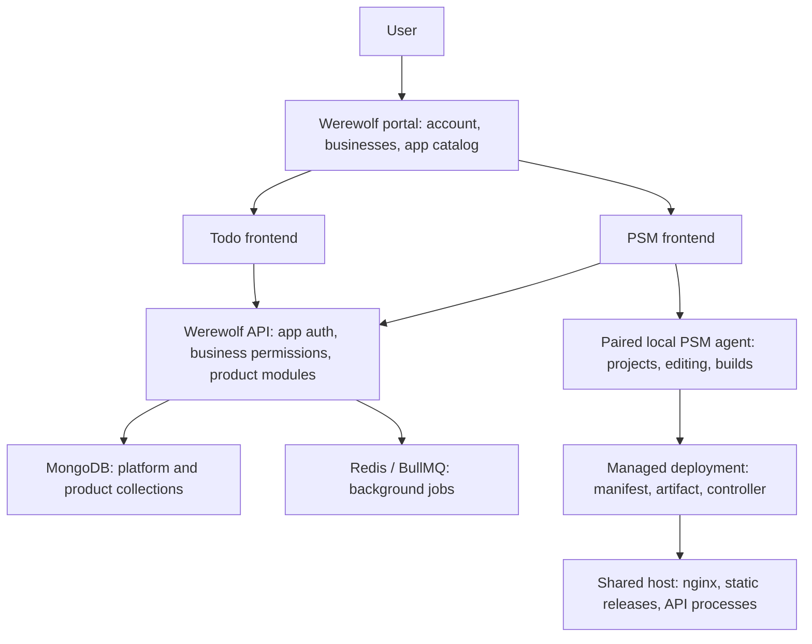

# Werewolf ecosystem integration assessment

Reviewed 2026-09-21. Inventory scope: 62 sibling project directories, excluding
docs, imgs, text-files and hidden workspace metadata. Code-level review focused
on psm, todo-app and werewolf-dapp. Other projects were classified from the
workspace inventory and their top-level structure; they have not all been
audited for production readiness.

This is a historical assessment. Its missing-work and setup findings describe
September 21, not current release status. Use the [delivery index](README.md)
and [acceptance evidence register](acceptance-evidence.md) for subsequent Todo,
GitHub App and service-release results and the current development sequence.

## Recommended direction

Use werewolf-dapp as the customer entry point and authority for accounts,
business membership and the app catalog. Use PSM as the developer/operator
workspace for creating, editing, building and releasing projects. Todo is the
first independently released frontend using those shared services.

The present system is already a modular platform: static product frontends,
a shared Express API, MongoDB and Redis/BullMQ, nginx and PM2. Keep that working
shape for the first release. Treat containers, OIDC-provider migration and
service extraction as subsequent changes with separate acceptance criteria.



The customer catalog and PSM's project inventory are different:
customers see published products they can use; developers see repositories,
experiments, tools and sites they are authorized to work on.

## What exists and what is missing

| Project | Already present | Integration work |
| --- | --- | --- |
| werewolf-dapp | Registration/login, business CRUD/switcher, shared product API, app-scoped authorization-code + PKCE sessions, CloudApplication registrations | Authenticated product catalog, tenant-aware app launches and entitlements, consistent business authorization |
| todo-app | React/Vite board, notes, OKRs, shared sign-in, project links, immutable static build workflow and PSM manifest | Complete staging release; explicitly model personal/business workspaces and safe sharing |
| psm | Sibling-folder inventory, scaffold/work sessions, local agent pairing, Todo project integration, deployment manifests/plans/connections | Finish shared release controller and target enrollment; provide a repeatable new-app onboarding path |

Evidence: werewolf-dapp/server/routes/api/v1/appAuth.js,
server/middleware/appAuth.js, server/models/CloudApplication.js,
client/src/components/business/BusinessSwitcher.tsx;
todo-app/client/src/auth/ and .psm/deployments.json;
psm/src/server/deploy/ and psm.config.json.

The portal header currently has Dashboard, Budgets, Payments, Calendar and
Settings; its homepage links to PSM. That is not yet a reusable customer app
catalog. Todo's backend is a module of werewolf-dapp, not a standalone service.
PSM's hosted frontend needs the paired local agent for filesystem operations.

## Findings that affect rollout

### 1. Todo team visibility is not tenant isolation

In werewolf-dapp/server/controllers/todoController.js,
todoObjectivesController.js and todoNotesController.js, readScope is:

```js
{ $or: [{ user: req.user._id }, { visibility: 'team' }] }
```

The team clause contains no business or membership predicate. protectApp
checks user, app audience, session and scopes, but supplies no business-membership
boundary. CloudApplication.business identifies the app's publisher; it is not
the consuming customer's business.

This is observable, not just a hypothetical query concern: the existing
todoNotes integration test creates two users without business memberships and
allows one to read the other's team-visible note. The shared-note and private-note
tests both passed against an isolated local audit database on 2026-09-21.
Private notes remained hidden; team notes were readable without membership.

Before unrelated businesses use Todo, require tenant-scoped reads and writes,
including notes, OKRs, board trees, exports, suggestions, counts and PSM's Todo
views. A UI business selector or an unvalidated businessId query parameter is
not authorization. Legacy shared data must fail closed until ownership is
explicitly assigned. Do not automatically assign it to the publishing business.

**Confirmed user decision, 2026-09-21: personal and business workspaces for both
Todo and PSM.** This is the agreed model. The implementation (werewolf-dapp
0.5.2, Todo 0.6.0, PSM 0.3.0) is done and tested against isolated databases.
The **werewolf-dapp side is deployed to staging at 0.5.1**, which already
carries the workspace API; 0.5.2's fixes, Todo 0.6.0 and PSM 0.3.0 are committed
locally and deployed nowhere. See
[workspace-implementation-status.md](workspace-implementation-status.md) for
exactly what is verified, what is merely committed, and what is outstanding.

- A personal workspace belongs to one user and keeps their personal tasks and
  projects private by default. Joining a business does not expose that work.
- A business workspace belongs to one Business. Access comes from that
  business's current membership and roles, checked by the API.
- Each task or project belongs to exactly one workspace. Notes, objectives,
  task trees and project-linked views must enforce the same workspace boundary.
- The portal and apps expose the selected workspace. Switching it changes the
  view and creation context; it does not move existing data or grant access.
- Moving work between personal and business workspaces requires an explicit
  transfer with permission checks on both sides and defined handling of linked
  records. Existing personal work is not automatically assigned to a business.
- A business membership grants no local filesystem or deployment credentials:
  PSM's paired-agent and deployment permissions remain separate.

Keep immutable user identity separate from business/workspace identity. Preserve
existing user-owned records in personal workspaces during migration; legacy
team-visible records must not become globally shared or acquire a business by
guessing from the app's publisher.

### 2. The automated release path is unfinished

Public staging health, Todo API protection, and Todo's registered callback
already work. The Todo hostname has no DNS answer and there is no active static
release. PSM's host credential was repaired using the existing local staging
key; its helper now responds.

The enrolled target and connection scope still use the generated staging root,
so the new root is correctly rejected. The expected deployment-control repository
cannot be resolved through the current GitHub login, and the GitHub connection
has no pinned release controller. The checked-in controller draft still requires
its artifact-reader GitHub App and release-only target credentials.

See [Todo staging](../deploy/TODO-STAGING.md) and the
[full runbook](../../../todo-app/docs/DEPLOY.md).
Credential repair is complete; DNS, host enrollment, source publication and
deployment have not been executed.

### 3. Validate browser ingress, not only HTTP status

psm/host-helper/nginx.go renders a default-src 'self' CSP without an explicit
cross-origin API allowance. It also adds Cache-Control in child locations:
nginx header inheritance must be tested so HTML does not lose the security
headers. A correct final policy needs the selected environment's API in
connect-src and the app's actual style requirements, on the responses the
browser really loads. Do not solve this by allowing arbitrary origins.

Verify sign-in, refresh and normal API calls in a browser after deployment.
A 200 for the SPA and a 401 for a protected API route alone do not establish that
a browser can use the app.

### 4. Documentation has drifted from running systems

Older runbooks say Todo's staging API/registration are missing and that PSM has
no connections. Those statements are superseded by live checks above.
The retained production configuration is only a reference while Todo staging
owns todo.werewolf.solutions. A hostname is not proof of which database or
identity environment a build uses.

## Product/platform contract

An app catalog entry should identify: stable app key, name/description, platform
(web/desktop/mobile), environment-specific launch URL, supported workspace kinds,
required scopes and availability. Keep it separate from secrets, deployment
credentials and billing records. Extend/reuse CloudApplication's identity rather
than introducing a conflicting second app key registry.

Business access should come from membership plus an app entitlement/installation
record, with owner/admin/member roles enforced server-side. Support personal
use alongside business workspaces. An account can belong to several businesses; choosing one
does not grant access to another.

A launch passes an app key and selected workspace as context. The destination
validates membership using its own app-scoped session. Never put access tokens,
refresh tokens, signing secrets or local-agent pairing tokens in launch URLs.
Keep local-agent pairing as a separate authority: customer SSO does not grant
access to a developer's disk.

The existing authorization-code + PKCE implementation is custom app auth. This
review did not establish full OpenID Connect compliance. If external clients,
MFA/federation or centralized lifecycle management justify it, evaluate a
provider such as Keycloak at accounts.werewolf.solutions, with a deliberate
existing-user/session migration. Werewolf should retain business membership and
product authorization. Avoid adding a second password store during Todo staging.

## Infrastructure and repositories

One host can serve several apps. Today Todo and PSM are static files, so extra
Node processes would provide no benefit. The documented host is 1 GB and already
runs production/staging services; current memory headroom was not measured.

When moving runtimes to Docker Compose, preserve public URLs and introduce
separate staging/production networks, database names, credentials, volumes and
resource limits. Build immutable images in CI. Rehearse restore and rollback
before switching the running API. Compose supports single-server deployment:
[Docker production guidance](https://docs.docker.com/compose/how-tos/production/).

Use the existing Redis/BullMQ for current background work. It is not a general
cross-product event contract. Add a broker when there are independent consumers
that need it; define versioned events with event ID, business/workspace ID,
producer and timestamps, plus an outbox/retry strategy and idempotent consumers.
[BullMQ's idempotency guidance](https://docs.bullmq.io/patterns/idempotent-jobs)
applies to existing retryable jobs too.

MongoDB currently hosts product-prefixed collections in a shared API/database.
Do not claim database-per-app isolation already exists. Enforce module ownership
now; when extracting a service, give it its own database credentials and make
other services use its API/events rather than reading its collections.

The workspace is multiple Git repositories, not one monorepo. Keep the existing
release branches/history while standardizing contracts. Start sharing versioned
theme, auth-client, API-contract and validation packages only where useful.
A monorepo migration can be evaluated separately; it is not a prerequisite for
cross-project integration or independent deployment.

For future identity work, use the provider's documented authorization-code flow
and exact client registration:
[Keycloak OIDC](https://www.keycloak.org/securing-apps/oidc-layers).

## Delivery sequence and acceptance

1. **Todo staging:** complete the target/controller setup, publish a validated
   artifact through PSM, and exercise sign-in, refresh, task editing and rollback.
   Use test data. The live site must identify staging; production remains gated.
2. **Business/workspace boundaries:** implement the confirmed personal-and-business
   workspace model, migrate existing ownership deliberately, centralize membership
   enforcement and test personal/business isolation, two unrelated businesses,
   a multi-business user, a revoked member, and direct-object access.
   Close the team-visibility finding before external multi-business use.
3. **Werewolf app catalog:** register Todo and PSM with real environment-specific
   availability. A signed-in user can manage businesses, select a workspace, see
   eligible apps and launch them. An unavailable app has a useful state.
4. **PSM onboarding recipe:** starting from an existing repo or a scaffold, attach
   a stable project ID, app registration metadata, build profile, deployment
   manifest, health/auth probes and release metadata. Reuse scoped connection
   profiles and controller code; keep per-target enrollment explicit. Re-running
   preparation should converge without duplicating DNS records or app registrations.
5. **Prove reuse with a second product:** choose a small web product, then handle
   desktop/mobile artifacts with their own release recipes. Automate promotion
   only after readiness, rollback and tenancy checks have been proven.
6. **Infrastructure evolution:** restore-tested backups and monitoring first,
   then containers, shared libraries and service extraction where they pay off.

"Automatic rollout" should mean one consistent prepare/check/release operation
after onboarding. The system still needs explicit product metadata, deployment
authority and tenant permissions; these cannot be inferred from a folder name.

## Remaining workspace: rollout groups

This is routing guidance, not a declaration that these apps are production-ready.
PSM's [generated inventory](../../PROJECTS.md) remains the project rundown.

| Group | Projects | Integration route |
| --- | --- | --- |
| Business/web products | atlas, local-lift, leads-search-skill, AI-social-media-autopilot, trading-bot, ultimate-app, feedback-hub | Catalog, tenant/auth adapter, product-owned data, web/service deployment recipe |
| Payments and blockchain | nfc-pay, qr-pay, qr-mobilepay, dao-project, dao-project-hardhat, smart-contracts, uniswap-liquidity-provider | Platform identities where appropriate; separate mobile/contract release and financial review boundaries |
| Infrastructure and automation | daedalus, control-room, workflow, aurora, archimedes, themis | Reuse bounded capabilities through PSM; keep a single owner for each infrastructure operation |
| Desktop and native | proteus, bedrock-forge, desktop, ws-desktop | Download/catalog entry plus native session flow and platform packaging |
| Business sites and commerce | handymanservices, manu-ncc-website, print-shop, print-shop-alpha-test, e-commerce, co-working, custom-checkout-template, print-shop-template | Link business + project; static/site or commerce recipe according to actual runtime |
| Shared tools/libraries | accounting, components, helpers, screenshot, qr-gen, github-api, mock-server, cookie-server | Shared package/capability or developer utility; no customer tile required by default |
| Content and planning | blog, todo, team, courses, file-account-company-house-uk, ai-assistant | PSM inventory/capabilities; publish only where there is a user-facing product |
| Legacy/demos/variants | aurora-v0.4.1, dao-dapp, dapp, dapp-demo, mern-app, next-demo-website, react-demo-website, werewolf-dapp-old, werewolf-old, werewolf-web-app, werewolf-web-app-old, werewolf-website-backup-old, werewolf-website-old | Confirm ownership and archival status before onboarding; do not automatically deploy every folder |

## Changes and verification in this preparation

- Repaired PSM's saved Todo staging SSH credential and verified a read-only
  host-helper response. No credential contents were logged.
- Changed Todo's active manifest to staging at todo.werewolf.solutions and
  preserved the previous production manifest outside the active configuration.
- Added a visible staging marker and a link to the matching Werewolf account;
  bumped Todo to 0.5.2.
- Updated staging runbooks with current observations and concrete blockers.
- Todo's four existing tests and the staging TypeScript/Vite build passed.
  Both manifest files passed PSM's parser.
- Ran the two existing shared/private note tests against an isolated local
  database; both passed and substantiate the authorization finding above.

This is a reviewed integration plan and local staging preparation, not a claim
that the app catalog, business workspaces, OIDC migration or deployment are done.

## Company-owned service direction, October 6, 2026

The operator wants all company applications and supporting services owned by
Werewolf Solutions, aiming for zero external service accounts. Start with
[Werewolf Watch](../deploy/WEREWOLF-WATCH.md), replacing required Better Stack
signup. Inventory remaining external accounts (including source/build hosting,
DNS/cloud control and notifications), define company-owned replacements and
measurable migration/recovery acceptance before removing each dependency.
Do not call this goal achieved while GitHub/DigitalOcean integrations remain.
